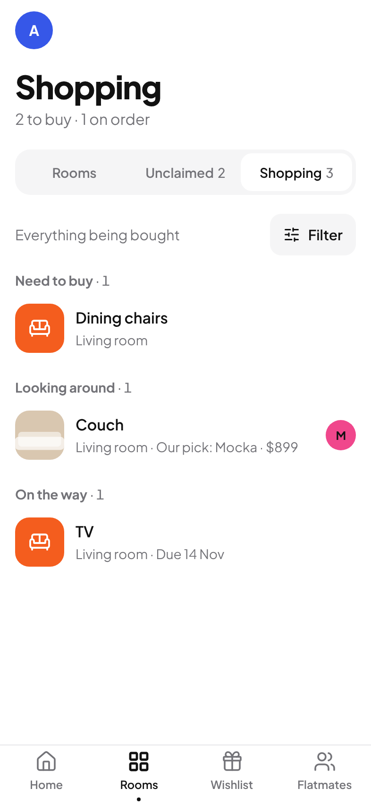
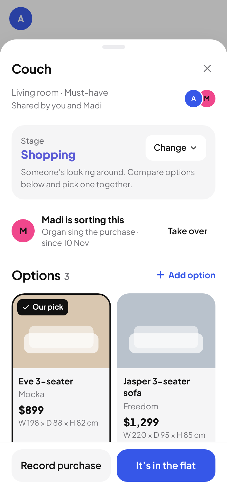
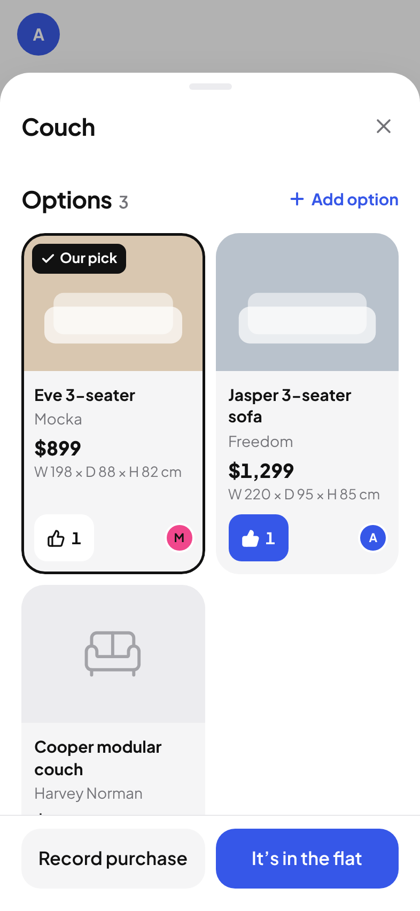

# Flat Quest — Phase 4 Implementation Report: The Shopping Experience

| | |
| --- | --- |
| Repository | `JayJett/Flat-Quest` |
| Feature branch | `phase-4-shopping`, base `e55946a` (end of Phase 3) |
| Pull request | [JayJett/Flat-Quest#2](https://github.com/JayJett/Flat-Quest/pull/2) |
| Supabase project | `flat-quest` (`ivnovvdpkxrqsmsiqhid`, Postgres 17) |
| Live app | https://jayjett.github.io/Flat-Quest/ |
| Report date | 11 November 2026 (UTC) / 12 November 2026 (Pacific/Auckland) |

> **How to read the evidence in this report.** Each result is labelled with where it came from:
>
> - **Unit** = Vitest, in this sandbox.
> - **Browser (fixtures)** = Playwright against the production build. Every Supabase HTTP and WebSocket request is intercepted and answered by an in-memory fixture ("Our Flat", "Alex", "Madi"). No browser test touches the real project. The fixture imitates the database rules; it does not prove them.
> - **Local DB** = a disposable plain Postgres 16 in this sandbox with a small stand-in for the Supabase schemas (`supabase/tests/local_shim.sql`).
> - **CI DB** = GitHub Actions, a real disposable local Supabase stack (`supabase start`). This is the authoritative check of the database rules.
> - **Live DB** = read or written on the real project through the Supabase connector.
> - **Not tested** = not exercised. Nothing in this phase was tested on a physical phone, and realtime between two real devices was not exercised.

---

## A. Executive summary

Phase 4 turns the checklist into a shared shopping companion. Four people can now see what needs buying, compare several products for one item, say which they prefer, pick one, agree who is sorting the purchase, record the order and its delivery, and confirm when it is physically in the flat.

The main design decision was to add **no second list and no second status**. Shopping is another way of looking at the same items. The purchase stages are new values of the existing `items.status`; the amount paid is the existing `items.actual_price`; "It's in the flat" is the existing `is_complete`. Everything new hangs off an item in four small relational tables.

**Delivered**

- A Shopping view inside Rooms, with a shortcut on Home. The bottom navigation still has four tabs.
- Product options per item: shop, price, link, optional photo, size, notes, who added it.
- One preference per member per item, separate from wishlist votes, and an explicit household pick that keeps the alternatives.
- Purchase coordination ("Madi is sorting this"): claim, release, hand over, take over.
- Purchase and delivery records, saved atomically with the item's stage and amount.
- Optional measurements for products and rooms, with a rough, caveated comparison.
- Realtime wiring, optimistic updates with rollback, stale-write refusal and offline refusal for all of it.

**Verification at a glance**

| Area | Result | Evidence |
| --- | --- | --- |
| Lint, type-check, production build | Pass | Sandbox and GitHub Actions |
| Unit tests | **91 / 91** (34 new) | Unit |
| Browser tests | **99 passed, 3 skipped by design**, of 102 (3 projects × 34) | Browser (fixtures), GitHub Actions incl. WebKit at 320 × 568 |
| Access suite | **163 / 163** (83 new) | CI DB and Local DB |
| Concurrent claims, selections, preferences | 6 / 6 | CI DB and Local DB |
| Migration applied to production | Done; schema matches the tested one | Live DB |
| Existing household data | Unchanged, row for row | Live DB fingerprints |

**What was not verified:** physical devices, realtime between two real sessions, and real uploads to Supabase Storage from a browser (section J).

---

## B. Features completed

### B1. Shopping view (`/rooms/shopping`)

- Reached from the **view switch on Rooms** (Rooms · Unclaimed · Shopping) and from a **Shopping row on Home** that appears when something is being bought. The Rooms tab stays highlighted; there is no fifth tab.
- A headline with two real counts: how many items are to buy and how many are on order.
- Items are grouped by stage: *Need to buy*, *Looking around*, *Ordered*, *On the way*, *Ready to collect*, *Delivered, not set up yet*, *Recently bought*. Empty groups are not shown.
- Each row shows the item, its room, the most useful single fact (delivery date, the pick and its price, the number of options, or the estimate) and who is sorting it or who is on it. If the chosen option has a photo, the row leads with it.
- **Filter and sort** sheet: room, person, priority, stage; sort by stage, priority, room, price, name or arrival date. The filters live in the address bar, so Back, reload and shared links keep them.
- Undecided items are left out by default. A line at the bottom ("68 items are still undecided") opens them on request, and each can be moved on with **We need to buy this**.

### B2. The item's shopping sheet

Opening a row shows one sheet with everything about buying that item:

1. **Stage**, with a *Change* control (the same plan as the checklist) and a one-line explanation of what the stage means.
2. **Who is sorting the purchase**, with the actions that apply to you.
3. **Options**: a two-column grid of product cards, with *Add option*.
4. **Purchase**: a summary of what was recorded, with *Edit*.
5. A pinned action bar with the next step: **We need to buy this**, or **Record purchase / Order details** beside **It's in the flat**.

The same sheet opens from an item's details in any room (a new *Shopping* row in the item sheet), so Rooms, Home and Shopping all lead to one place.

### B3. Product options and comparison

- **Add option**: product name, shop, price, link, width/depth/height, notes and an optional photo. Only the name is required.
- **Cards** show the photo (or a quiet placeholder using the room's icon), name, shop, price, size, how many prefer it and who.
- **Option details**: larger photo, a *View at {shop}* link that opens in a new tab, size, notes, who added it and when, rough fit, preferences, **Choose this one**, Edit and Remove.
- **Prefer**: a thumb button on each card. Choosing another option moves your preference; tapping again removes it.
- **Our pick**: one option per item. Choosing a different one replaces the pick and keeps the previous option in the list. *Undo* clears it.

### B4. Purchase coordination

- Nobody yet → **I'll sort it**.
- You → **Hand over** (pick a flatmate) or **Release**.
- Someone else → **Take over**, with a confirmation that suggests a quick word first.
- The shopping list shows the person's avatar on the row.

### B5. Purchase and delivery

- **Record purchase** opens one form: which product (if there are options), bought by, date bought, amount paid, order reference, stage, delivery or pick-up, expected date, arrival date, tracking link, delivery notes and purchase notes. Every field is optional.
- Saving a first purchase moves a *Need to buy* or *Shopping* item to the chosen stage (Ordered by default).
- **It's in the flat** completes the checklist item, which updates the room, Home progress, the activity list and the milestone toast exactly as ticking the checkbox does. If a purchase record exists without an arrival date, today's date is filled in.
- Items with no options at all (the toilet-paper case) go through the same flow; the product field is simply absent.

### B6. Measurements

- Product options: width, depth, height in centimetres. Blank means unknown.
- Rooms: width, length, height and a "things to watch for" note, in the existing room sheet.
- Where a product and its room both have sizes, the option shows a short comparison and a fixed caveat.

---

## C. Design implementation

Nothing in the design system changed: no new colours, fonts, radii or shadow tokens. New screens are built from the existing primitives (`Sheet`, `ConfirmSheet`, `Button`, `Field`, `Segmented`, `EmptyState`, `Avatar`, `AvatarGroup`, `.field`, `.pressable`).

| New piece | File | Built from |
| --- | --- | --- |
| View switch | `src/components/RoomsViewSwitch.tsx` | The existing `Segmented`, now with three options |
| Shopping page and row | `src/pages/Shopping.tsx` | Same row rhythm as `ItemRow`; room colour tile from Home's room list |
| Filter sheet | `src/pages/Shopping.tsx` | `Sheet` with a footer; native selects in `.field` |
| Product card, prefer button, photo | `src/shopping/OptionCard.tsx` | `bg-surface-2` card at the card radius, like wishlist ideas |
| Option details and form | `src/shopping/OptionSheet.tsx` | `Sheet`, `Field`, `ConfirmSheet` |
| Item shopping sheet, coordinator row, purchase summary | `src/shopping/ShoppingSheet.tsx` | `Sheet`; pinned bar copied from the item sheet |
| Purchase form | `src/shopping/PurchaseSheet.tsx` | `Sheet`, `Field` |

**Decisions**

- **No shadows** on any card, row, button or bar. The only shadow is the existing one on sheets and toasts.
- **The pick** is marked by an inset ink outline and one plain "Our pick" label. The outline is a `box-shadow: inset` used as a border, not a drop shadow.
- **One accent per card**: the prefer button turns blue only when it is yours.
- **Native controls** for stage, filters and dates, so iOS shows its own pickers. Inputs stay at 16 px to avoid zoom on focus.
- **No decorative statistics.** The only numbers shown are counts of real items and real prices.
- **Copy** follows the existing voice: "I'll sort it", "We need to buy this", "It's in the flat", "Nothing to compare yet".

**Animation**

| Interaction | Motion |
| --- | --- |
| Shopping rows and option cards | Fade up on entry, collapse or shrink on exit (same values as `ItemRow` and `IdeaCard`) |
| Changing filters or sort | 180 ms cross-fade of the list |
| Header counts | Existing `AnimatedNumber` |
| Stage change | The new label fades up (200 ms) inside one live region |
| Preference | Thumb springs once, only when adding |
| Choosing the pick | Outline fades in (200 ms); label scales in |
| Coordinator change | 160 ms cross-fade of the line |
| Photo loaded | 200 ms fade |
| Purchase summary appearing | Fade up (220 ms) |
| Sheets | Existing spring in, 220 ms out |

No animation loops. All of it is disabled by the existing `MotionConfig reducedMotion="user"` and the reduced-motion media query.

---

## D. Shopping Mode: how it derives from the checklist

`src/lib/shopping.ts` holds the rules as pure functions; `tests/shopping.test.ts` covers them.

- **`shoppingGroupOf(item, purchase, now)`** returns the section an item belongs in, or `null`:
  - `not_needed` or `provided` → never.
  - Not complete, and status is one of the six purchase stages → that stage.
  - Not complete, `to_decide` or `bringing` → not on the list. Something a flatmate is bringing is never suggested for purchase; changing its plan to *Need to buy* is the explicit way to say it needs buying.
  - Complete → *Recently bought* only if there is evidence it was bought (a purchase stage, an amount paid, or a purchase record with content) and it was completed in the last 14 days.
- **`shoppingSummary(items)`** counts to-buy (need to buy + shopping), on order (ordered through delivered) and undecided.
- **`shoppingEntries` / `shoppingSections`** apply the filters and sorting. The person filter matches assignees and the purchase coordinator. Price sorting uses the amount paid, else the pick's price, else the cheapest option, else the estimate; unknown prices sort last.

There is no shopping table and no stored shopping state. Editing an item's plan in a room changes where it appears in Shopping, and the reverse (Browser (fixtures): "one status system").

---

## E. Product comparisons

**Data.** `product_options` rows belong to exactly one item (`(item_id, household_id)` foreign key to `items`). Three couches are three options under one checklist item, never three items.

**Preferences.** `product_preferences` has the primary key `(item_id, user_id)`, so a member can hold only one preference per item. `user_id` is not an insertable column; it defaults to `auth.uid()`, and the insert, update and delete policies all require `user_id = auth.uid()`. The option must belong to the same item (foreign key `(option_id, item_id)`). These are separate tables from `wishlist_votes`.

**Selection.** `product_options.is_selected`, with a partial unique index allowing one selected option per item. A trigger takes a row lock on the item, unselects the previous pick and records `selected_at` / `selected_by` from the session. Clients cannot write those two columns. Preferences never change `is_selected`.

**Photos.**

- Stored in the existing private `household-media` bucket under `<household-id>/products/<item-id>-<timestamp>.<ext>`. The Phase 2 storage policies already restrict that bucket to household members by the first path segment; a check constraint on `photo_path` additionally pins it to the household's own `products/` folder.
- On the device: type and size are validated (JPEG, PNG, WebP, HEIC; 15 MB input), the image is downscaled to at most 1200 px and re-encoded as WebP (JPEG fallback), which drops EXIF and location data, and the result is checked against the bucket's 3 MB limit, shrinking further if needed.
- A preview shows immediately. Nothing is uploaded until Save.
- Cleanup: if saving fails after the upload, the retry reuses the uploaded file, and closing the form removes it. Replacing or removing a photo deletes the old file after the save succeeds. Removing an option deletes its file. Deleting an item deletes its options' files.
- There is no scraping of retailer pages. Options without a photo show the room's icon on a neutral tile.

---

## F. Purchase coordination

**Model.** `purchase_coordinators` has one row per item (primary key `item_id`) naming the member who is sorting the purchase. It is unrelated to `item_assignees` (who is on the item), `owner_user_id` (who keeps it) and `item_purchases.purchased_by` (who bought it).

| Action | Who | How it is enforced |
| --- | --- | --- |
| Claim | Any member, for themselves | `INSERT`; `user_id` is not insertable and defaults to `auth.uid()`; policy requires `user_id = auth.uid()` |
| Release | The current coordinator | `DELETE` policy `user_id = auth.uid()` |
| Hand over | The current coordinator, to another member | `UPDATE user_id`; trigger requires the caller to be the old or the new coordinator; foreign key requires the new one to be a member |
| Take over | Any member, for themselves | Same `UPDATE`, filtered on the coordinator the screen was showing |
| Appoint a third person | Nobody | Rejected by the trigger (`42501`) |

**Concurrency.**

- Two simultaneous claims: both are inserts for the same primary key, so the database accepts one and rejects the other with `23505`. The app shows "Someone else just took this on" and the actual coordinator.
- Hand over and take over are compare-and-swap updates (`… where item_id = ? and user_id = <who I saw>`). If the coordinator changed in the meantime, zero rows match, nothing changes, and the app refetches and says so.
- The app does not show "You're sorting this" optimistically. It waits for the database.
- A second tap while a request is in flight is refused locally (Browser (fixtures): one request for a double click).
- If a member leaves the household, their coordinator rows and preferences are removed by foreign-key cascade; purchases they made stay, with the buyer cleared.

**Evidence.** CI DB and Local DB: `supabase/tests/coordinator_race.sh` opens 12 separate connections claiming the same item at once as two different users and requires exactly one success and one row. The same script fires 12 simultaneous selections (exactly one option ends selected, no errors) and 8 simultaneous preferences by one member (exactly one row).

---

## G. Measurements and delivery

**Measurements.** `numeric(6,1)` centimetres, nullable, with range checks: product options 0.1–2000, room width/length 0.1–5000, room height 0.1–1000. `fitGuidance()` compares the product's footprint with the room's floor in both orientations, and its height with the ceiling, and returns one of three verdicts:

- within the floor size (with the share of the longest wall),
- within it but taking 80% or more of the longest wall,
- bigger than the room.

It returns nothing unless both sides have enough numbers. The text never says the furniture "will fit", and it is always followed by: "A rough guide from the room's size only. It doesn't know about doorways, stairs, hallways, corners or which way the furniture faces." There is no 3D or AR.

**Stages.** One field, `items.status`:

`to_decide` · `bringing` · **`need_to_buy` → `shopping` → `ordered` → `on_the_way` / `ready_to_collect` → `delivered`** · `provided` · `not_needed`

The three in bold after `ordered` are new in Phase 4. "Not purchased" is simply any stage before `ordered`. Completion remains `is_complete`, set only by "It's in the flat" or the checkbox, so *Ordered* and *Delivered* items stay open and do not count as ready.

**Purchase record.** `item_purchases` (one optional row per item): chosen option, buyer, purchase date, order reference, notes, delivery method (`delivery` or `pickup`), expected date, tracking link, delivery notes, arrival date. The amount paid is not stored here; it is `items.actual_price`, the same "Spent" field the item sheet edits.

**Dates.** Purchase, expected and arrival dates are Postgres `date` values, entered with native date inputs and handled as `YYYY-MM-DD` strings (`src/lib/dates.ts`). They are never converted through UTC, so "20 November" is the same day for everyone. "Today" is the device's local date.

---

## H. Supabase implementation

One migration: `supabase/migrations/20261112000001_shopping.sql`. It is additive.

### Changes to existing tables

| Table | Change |
| --- | --- |
| `items` | `items_status_check` replaced to allow `on_the_way`, `ready_to_collect`, `delivered` as well as the seven existing values |
| `rooms` | New nullable columns `width_cm`, `length_cm`, `height_cm`, `measurement_notes` with range and length checks |

### New tables (all in `public`, RLS enabled, in the `supabase_realtime` publication)

| Table | Key | Purpose | Integrity |
| --- | --- | --- | --- |
| `product_options` | `id` | Candidate products for an item | FK `(item_id, household_id)` → `items` cascade; unique `(id, item_id)`; partial unique index one selected per item; checks on name, shop, price ≥ 0, http(s) link, photo path inside `<household>/products/`, sizes; 20 options per item |
| `product_preferences` | `(item_id, user_id)` | One preferred option per member per item | FK `(option_id, item_id)` → `product_options` cascade; FK `(item_id, household_id)` → `items` cascade; FK `(household_id, user_id)` → `household_members` cascade |
| `purchase_coordinators` | `item_id` | Who is sorting the purchase | FK to `items` cascade; FK to `household_members` cascade |
| `item_purchases` | `item_id` | Purchase and delivery details | FK to `items` cascade; FK `(option_id, item_id)` → `product_options` set null; FK `(household_id, purchased_by)` → `household_members` set null; checks on dates, delivery method, link, lengths |

### Policies and grants

All four tables: `revoke all` from `anon` and `authenticated`, then only what is needed.

| Table | Select | Insert | Update | Delete |
| --- | --- | --- | --- | --- |
| `product_options` | members | members; content columns and `is_selected` only | members; same columns | members |
| `product_preferences` | members | own row; `item_id`, `household_id`, `option_id` only | own row; `option_id` only | own row |
| `purchase_coordinators` | members | own row; `item_id`, `household_id` only | members, `user_id` only, guarded by trigger | own row |
| `item_purchases` | members | members; content columns only | members; content columns only | not granted |

"Members" means `private.is_household_member(household_id)`, the same helper every earlier policy uses. `created_by`, `selected_at`, `selected_by`, `updated_by`, `claimed_at` and timestamps are set by triggers and are not writable by clients. `TRUNCATE`, `TRIGGER` and `REFERENCES` are not granted on the new tables.

### Functions

| Function | Security | Purpose |
| --- | --- | --- |
| `private.product_options_guard()` | invoker, trigger | Fixes household and item; sets `created_by`; caps options per item; on selection locks the item, retires the previous pick, records who and when |
| `private.purchase_coordinators_guard()` | invoker, trigger | Fixes item and household; a change of coordinator must involve the caller; resets `claimed_at` |
| `private.item_purchases_guard()` | invoker, trigger | Fixes item and household; sets `updated_by` |
| `public.save_item_purchase(...)` | **invoker**, RPC | Locks the item, checks the versions the form was opened with, writes the purchase row and, if asked, the item's stage and amount, all in one transaction. Raises SQLSTATE `FQ409` and writes nothing if anything changed underneath. Execute granted to `authenticated` only |

**No `SECURITY DEFINER` function was added in Phase 4.** Every statement runs under the caller's RLS. The ten existing definer RPCs from Phases 1–2 were not changed.

### Storage

No bucket or policy changes. Product photos use the existing private `household-media` bucket (3 MB, JPEG/PNG/WebP) and its four member-only policies.

### Realtime

A second channel, `shopping:<household>`, subscribes to the four tables (filtered by household; DELETE events unfiltered because they only carry the primary key, as the Supabase docs describe). After a reconnect, on returning to the app after 30 seconds, and on coming back online, the provider refetches everything.

### Documentation consulted

- Realtime Postgres Changes, including the note that RLS is not applied to DELETE events: https://supabase.com/docs/guides/realtime/postgres-changes
- Column Level Security: https://supabase.com/docs/guides/database/postgres/column-level-security
- Row Level Security: https://supabase.com/docs/guides/database/postgres/row-level-security
- Securing your API: https://supabase.com/docs/guides/api/securing-your-api

`@supabase/supabase-js` stays pinned at 2.119.0; nothing in this phase needed a newer client.

### Types

`src/lib/database.types.ts` (the project's trimmed, hand-maintained copy) gained the four row types, the room columns and the RPC signature.

### Advisors

Run on the live project after the migration.

- **Security:** no new warnings. The same 10 "signed-in users can execute SECURITY DEFINER function" warnings as after Phase 2 (all existing, intended RPCs; none added) and the existing "leaked password protection disabled" setting. Two *info* notices say the private safety copies (`private.phase4_pre_items`, `private.phase4_pre_rooms`) have RLS on and no policies, which is the intent: nobody but the database owner can read them.
- **Performance:** *info* only. "Unused index" on the new tables' indexes (they are empty and minutes old) and "no primary key" on the two safety copies. Every foreign key on the new tables has a covering index.

---

## I. Data preservation

**Approach.** The migration only adds tables and nullable columns and widens one check constraint. It does not update or delete any existing row. It was applied to production **before** the new frontend was published; the previous app ignores the new columns and tables, so nothing broke in between.

**Recovery plan, in place before the migration:**

1. Private copies of the two tables whose definitions change: `private.phase4_pre_items` and `private.phase4_pre_rooms` (`supabase/rollback/pre_phase4_snapshot.sql`). The `private` schema is not exposed by the API.
2. A tested reverse script, `supabase/rollback/20261112000001_shopping_down.sql`. Local DB: migrate → roll back → migrate again → 163/163.
3. Row counts and whole-row fingerprints recorded before and after (below).
4. Supabase's own daily backups remain available as a last resort.

**Live DB counts**

| Record | Before (09:16 UTC) | Just before migration (18:28 UTC) | After migration (18:30 UTC) | Fingerprint unchanged |
| --- | ---: | ---: | ---: | --- |
| Households | 1 | 1 | 1 | Yes |
| Members | 3 | 3 | 3 | Yes |
| Profiles | 3 | 3 | 3 | Yes |
| Rooms | 11 | 11 | 11 | Changed as expected (4 new empty columns); 11 of 11 rows identical to the snapshot on every original column |
| Furnishing items | 104 | 104 | 104 | Yes |
| Item assignments | 37 | 37 | 37 | Yes |
| Wishlist ideas | 13 | 13 | 13 | Yes |
| Wishlist votes | 3 | 3 | 3 | Yes |
| Items in the flat | 6 | 6 | 6 | Yes (part of the items fingerprint) |
| Invite records | 2 | 2 | 2 | n/a |
| Stored files (1 household photo) | 1 | 1 | 1 | Yes (bucket and path) |
| Rows in the four new tables | n/a | n/a | 0 | n/a |

Item plans before and after: 68 to decide, 18 bringing, 8 shopping, 4 need to buy, 6 provided. So the live household will open Shopping to 12 items (4 to buy, 8 being looked at) and a link to 68 undecided ones.

Schema check after applying (Live DB): RLS on for 4 of 4 new tables; 4 of 4 in the realtime publication; 15 policies; 51 column-level insert/update grants; no table-level insert or update grants; 0 new definer functions; the four function definitions hash identically to the ones in the locally tested database.

**After deployment (18:40 UTC, Live DB):** the same counts and the same fingerprints for households, members, profiles, items, assignments, wishlist ideas, votes and stored files as before the migration; rooms unchanged since the migration; the four new tables still empty; no test users present. Nobody's data was touched by publishing the new app.

Fingerprints are an MD5 over every row's full text, ordered by primary key. `rooms` is expected to change, because each row gained four empty columns; its original column values were compared separately against the snapshot.

No household, member, invite, assignment, wishlist idea, vote, photo, colour, price or completion record was changed, re-imported or deleted.

---

## J. Tests

### Commands and results

| Command | Where | Result |
| --- | --- | --- |
| `npm run lint` | Sandbox; GitHub Actions | 0 problems |
| `npm run typecheck` (`tsc -b --noEmit`) and `tsc -p tsconfig.test.json --noEmit` | Sandbox | 0 errors |
| `BASE_PATH=/Flat-Quest/ npm run build` | Sandbox; GitHub Actions | Succeeds |
| `npm test` | Sandbox; GitHub Actions | **91 passed** (57 before this phase) |
| `npx playwright test --project=desktop-chromium --project=reduced-motion` | Sandbox (pre-installed Chromium) | **67 passed, 1 skipped** (the reduced-motion check is skipped in the desktop project) |
| Same suites at 320 × 568 in Chromium emulation (temporary local config) | Sandbox | **32 passed** (reduced-motion check skipped) on the run before the last test was added; WebKit itself is not installed here |
| `npm run test:browser` (desktop Chromium, 320 × 568 WebKit, reduced-motion Chromium) | GitHub Actions | First push: **96 passed, 3 skipped**. Final head: **99 passed, 3 skipped**; production run on the merge commit: **99 passed, 3 skipped** |
| `supabase/tests/run_local.sh` (all 13 migrations from scratch, access suite, race script) | Local DB | **163 / 163**, race **6 / 6** |
| Migrate → `supabase/rollback/…_down.sql` → migrate → access suite | Local DB | **163 / 163** |
| `psql … -f supabase/tests/rls_verification.sql` on `supabase start` | CI DB | **163 / 163** on both pushes |
| `supabase/tests/coordinator_race.sh` on `supabase start` | CI DB | **6 / 6** on both pushes |
| Security and performance advisors | Live DB | No new warnings (section H) |

The three skipped browser tests are deliberate: the reduced-motion assertion only runs in the reduced-motion project (skipped in the other two), and the Phase 3 service-worker test only runs in Chromium (skipped in WebKit).

The access suite and the race script create throwaway users and households and remove them (the suite runs inside a transaction that is rolled back). **They were not run against production in this phase**, by design: the production schema was instead compared with the tested one (section I).

### What the Phase 4 tests cover

**Unit (`tests/shopping.test.ts`, 34 tests):** stages are ordinary statuses and never imply completion; what is and is not on the shopping list; recently bought needs evidence and a 14-day window; filters by room, person, priority, stage; all six sorts with unknowns last; preference tally; the pick sorts first regardless of popularity; price and centimetre parsing and formatting; fit guidance in both orientations and for height, and that its wording never promises a fit; local "today", real-date validation, daylight-saving day counts; delivery wording; link validation.

**Browser (fixtures) (`tests/browser/phase4.spec.ts`, 22 tests per project):**

| Test | Covers |
| --- | --- |
| The shopping journey | All twelve steps in the brief, in one run, in the Auckland time zone just after midnight: needs buying → appears in Shopping → option added → competing option from a flatmate → different preferences, one each → pick chosen, alternative kept → coordinated, assignees and ownership unchanged → purchase recorded, amount in `actual_price` → delivery stage → in the flat → arrival date is the local date → milestone toast → Home progress, room checkbox and activity list agree |
| Leaves out what nobody needs to buy | Bringing, provided, not needed, completed-without-purchase; undecided on request; "We need to buy this" |
| Filters and sorting | Each filter, combined filters, reload keeps them, price and name sort, reset |
| Lost claim race | Refusal message, real coordinator shown, take over with confirmation, hand over, stale take-over changes nothing, release |
| Double tap | One request |
| Photo upload | Unsupported file refused; preview; failed save keeps the draft; retry does not upload twice or create twice; replace and remove delete the old file |
| Abandoned upload | Closing after a failed save removes the file |
| Validation | Name, price, link, sizes; nothing sent while invalid; blank sizes allowed |
| Failed preference / stale option edit | Rollback; draft kept; flatmate's value not overwritten |
| Removing options, deleting an item | Item survives; item deletion removes option photos |
| No-option purchase | Delivered is not complete |
| Finished item | Adding purchase details does not change its plan |
| Stale purchase form | Failed save changes nothing; stale save refused without overwriting; reopen and save |
| Room measurements | Invalid rejected; saved; rough fit and caveat shown; too-big case; never "will fit" |
| One status system | Plan set in the item sheet shows in Shopping and the reverse |
| Shopping unavailable | Checklist still works; error with retry; recovers; no page errors |
| Offline | Preference, claim and stage change refused locally; nothing sent |
| Navigation | Home shortcut, view switch, exactly four tabs, Rooms highlighted |
| Layout | No horizontal overflow; cards inside the viewport; pinned buttons fully visible and at least 44 px tall |
| Keyboard | Enter opens a row; Space records a preference without opening the card; Escape closes only the top sheet and returns focus |
| Reduced motion | Feedback is instant (reduced-motion project only) |
| Wishlist | Still loads; votes are separate from preferences |

The 12 Phase 3 browser tests still pass unchanged in every project (regression: celebrations, activity, conflict-aware editing, nested sheets, offline, partial create, lazy routes, tour, offline fallback).

**Database (`supabase/tests/rls_verification.sql`, 163 checks; 83 new):** purchase stages on the existing status; option attribution and unwritable server columns; price, link, size and photo-path validation; options cannot move items; one preference per member; no preferences on someone's behalf; preference must match the item; preferences never select; selection records who and replaces the previous pick; claim, duplicate claim, claim in someone's name, release of someone else's role, stale and valid take-over, appointing a third person, handing to a non-member, hand over; assignees and ownership unchanged by coordination; purchase saved with stage and amount; ordered and delivered not complete; stale version, stage and amount refused and nothing written; buyer must be a member; option must belong to the item; unknown method and stage; bookkeeping columns and delete not allowed; purchase without options; deleting an option keeps the purchase and only that option's preferences go; room measurements; an outsider sees and can change nothing across all four tables, including through their own household; storage rule for the products folder; a leaving member's preference and coordination go, their purchase stays; anon denied on all four tables and the RPC; RLS on, realtime on, no new definer functions, no truncate/trigger/references grants.

### Failures found and fixed during the work

| Found by | Problem | Fix |
| --- | --- | --- |
| Local DB | Two of my own new assertions were wrong: one read a deleted row's effect inside the same statement; one consumed an invite use and changed a later Phase 2 check | Rewrote the assertions; the database behaviour was correct |
| Browser | Opening a sheet and acting within 30 ms lost keyboard focus, because the focus trap moved focus to the sheet even when focus was already inside it | `useFocusTrap` now leaves focus alone if it is already inside (`src/components/Sheet.tsx`) |
| Browser | The stage label was two live regions during its transition | One live region; only the incoming text animates |
| Visual review | At 320 px the item's context line was truncated, the coordinator line wrapped to three lines and "Record purchase" wrapped | Moved *Edit item* below the content, shortened the line, sized the two pinned buttons for narrow screens |
| Review of my own code | Editing purchase details on an item whose plan was not a purchase stage would have changed its plan to *Ordered* | The stage is only written when recording a first purchase for a to-buy item or when changed on purpose; covered by a new test |
| Sandbox | The Supabase container images could not be pulled here (registry blocked by the network policy) | Ran the suites on plain Postgres with a small shim locally; CI runs the real stack |

### Not tested

- Any physical device, iOS Safari, Add to Home Screen, real touch keyboards, real date pickers.
- Realtime between two real sessions. The subscription code follows the Phase 2 pattern, but browser tests switch WebSockets off and simulate a flatmate by changing fixture state and resyncing.
- A real photo upload to Supabase Storage from a browser, and HEIC decoding (which depends on the browser).
- Screen-reader walkthrough. Roles, names and live regions are asserted by tests, not listened to.
- WebKit locally: it is not installed in this sandbox. Locally the 320 × 568 layout was run in Chromium emulation; the real WebKit project runs in CI.

---

## K. Visual QA

All screenshots use **invented fixture data** ("Our Flat", Alex and Madi). Product photos are flat colour swatches, not real products. They are regenerated by `SHOTS=1 npx playwright test screenshots --project=desktop-chromium`.

Sizes: `p4-m-*` 393 × 852 at 2×, `p4-se-*` 320 × 568 at 2×, `p4-d-*` 1440 × 900.

| Screen | Mobile | Small iPhone | Desktop |
| --- | --- | --- | --- |
| Home with the Shopping shortcut | `p4-m-home-shortcut.png` | `p4-se-home-shortcut.png` | `p4-d-home-shortcut.png` |
| Rooms with the three-way switch | `p4-m-rooms-switch.png` | `p4-se-rooms-switch.png` | `p4-d-rooms-switch.png` |
| Shopping list | `p4-m-shopping.png` | `p4-se-shopping.png` | `p4-d-shopping.png` |
| Filter and sort | `p4-m-filters.png` | `p4-se-filters.png` | `p4-d-filters.png` |
| Item shopping sheet | `p4-m-item-sheet.png` | `p4-se-item-sheet.png` | `p4-d-item-sheet.png` |
| Comparing options | `p4-m-compare.png` | `p4-se-compare.png` | `p4-d-compare.png` |
| Option details | `p4-m-option.png` | `p4-se-option.png` | `p4-d-option.png` |
| Rough fit | `p4-m-option-fit.png` | `p4-se-option-fit.png` | `p4-d-option-fit.png` |
| Option form | `p4-m-option-form.png` | `p4-se-option-form.png` | `p4-d-option-form.png` |
| Purchase form | `p4-m-purchase-form.png` | `p4-se-purchase-form.png` | `p4-d-purchase-form.png` |
| Delivery in progress | `p4-m-delivery.png` | `p4-se-delivery.png` | `p4-d-delivery.png` |

  

**Observations from reviewing them**

- The new screens read as part of the existing app: white ground, grey surfaces, black headings, colour only on room tiles, the primary button and the active preference.
- On desktop the sheets are centred dialogs and the shopping list is capped at a readable width. The list does not use the full width of a large screen; a two-column layout would be an improvement.
- Date inputs show the browser's own format. On an iPhone they open the native picker; in desktop Chrome they show `mm/dd/yyyy` placeholders.
- When every item is in the same room the list shows the same colour tile on each row. With several rooms the tiles vary.
- Screenshots were taken about half a second after each sheet opened, during the last moments of its spring.

---

## L. Known issues, limitations and trade-offs

1. **Not tested on real devices or with real realtime** (section J).
2. **Purchase stage and "in the flat" are two taps for a two-step reality.** *Delivered* exists for things that have arrived but are not set up. Most items will go straight from *Ordered* to "It's in the flat", which is supported.
3. **Coordinator rows are not cleared on completion.** The line is hidden once the item is in the flat. If the item is reopened, the same person is shown again.
4. **No purchase history.** A purchase record holds the current state. There is no log of stage changes and no per-person spending view; this phase deliberately stops short of accounting.
5. **One purchase per item.** Items bought in several parts (six chairs from two shops) have to be recorded as one.
6. **Deleting a room leaves its options' photo files in Storage.** Deleting an item or an option cleans up; deleting a whole room cascades in the database but the app does not walk its photos. The files are unreachable by non-members but are not removed.
7. **Photo cleanup is best effort.** If the app is closed between an upload and its save, the file remains.
8. **Stale-edit handling is "refuse and keep the draft", not merge.** After a refusal the user reopens the form and re-enters what still applies.
9. **Selecting an option updates its `updated_at`**, so someone editing that option at the same moment will be asked to reopen it.
10. **Fit guidance is deliberately crude.** It compares rectangles with a room's rectangle. It ignores other furniture, doors and windows.
11. **The existing single shopping link on an item is kept**, shown as "Saved link" in the shopping sheet. It is not converted into an option automatically (no live item has one).
12. **The CSV importer** accepts the new stage names, but the bundled checklist does not use them.
13. **Bundle size.** The shopping provider is part of the signed-in shell. Build output for the shell entry plus the shared chunk is 233.5 kB gzip (was 229.7 kB at the end of Phase 3); the item sheet chunk, which now contains the shopping sheets, is 19.6 kB gzip. The Shopping page itself is a 3.9 kB lazy chunk. These are build sizes, not device timings.
14. **Old open sessions.** A phone that still has the Phase 3 app open shows the three new stages as "To decide" until it reloads. It cannot damage them: Phase 3 only sends fields the user changed.
15. **Existing table grants.** `items` and `rooms` still carry Supabase's default table-level grants (including `TRUNCATE`) to `authenticated`, as they have since Phase 1. The REST API cannot issue `TRUNCATE`, and I left existing grants alone in this phase; tightening them is listed for Phase 5.

---

## M. Manual configuration

Nothing new is required for Phase 4 to work. No environment variables, buckets, auth settings or dashboard switches changed.

Optional, at your convenience:

1. **Drop the safety copies** once you are happy with Phase 4 (SQL Editor):
   ```sql
   drop table private.phase4_pre_items, private.phase4_pre_rooms;
   ```
2. **Try it on your phones.** Add two options to something, prefer different ones on two phones, and check each phone updates without a reload. That is the one behaviour this report cannot vouch for.
3. Still open from earlier phases: leaked-password protection, custom SMTP, Google sign-in (see the Phase 2 report, section 14).

---

## N. Recommended Phase 5

Based on what was built and what is still thin:

1. **Real-device and realtime pass**, then fix what it finds. This is now three phases overdue and is the largest unverified area.
2. **Activity for shopping**: "Madi added an option for Couch", "Jarden ordered the TV". This needs a small durable event table, which would also give *Around the flat* a real history.
3. **Spending summary**: a simple per-room and per-person total from `actual_price` and `purchased_by`, clearly not accounting.
4. **Comments on an item or option**, so the conversation about a couch stays with the couch.
5. **Wishlist → option**: turn a chosen wishlist idea (with its photo, price and link) into a product option on an existing item, not only into a new item.
6. **Household management** (remove a member, transfer ownership, change the limit), carried over from Phases 2 and 3.
7. **Hardening**: revoke unused default table privileges on Phase 1–3 tables; a scheduled sweep for orphaned photo files; clear a coordinator when an item is completed.
8. **Desktop layout** for Shopping (two columns or a side-by-side detail pane).
9. **Split purchases** if buying in parts turns out to be common.

---

## O. Deployment record

| | |
| --- | --- |
| Feature branch | `phase-4-shopping` |
| Pull request | [JayJett/Flat-Quest#2](https://github.com/JayJett/Flat-Quest/pull/2), merged with a merge commit |
| Commits | `4e4bee989c9e4e6b3639ebb087bab2282d6c8826` (Phase 4), `c80e279c46b1d3d53208f4a3bffe46b90b0cab1a` (purchase-stage fix, snapshot script) |
| Merge commit | `8801f9cb88bab97290f32a126cb460a6b0e0d9d3` |
| CI on the first push | [run 42999873166](https://github.com/JayJett/Flat-Quest/actions/runs/42999873166): Check and build success, Local database access tests success (Publish skipped, as on every pull request) |
| CI on the final head | [run 43078039558](https://github.com/JayJett/Flat-Quest/actions/runs/43078039558): both jobs success |
| Production run | [run 43078947055](https://github.com/JayJett/Flat-Quest/actions/runs/43078947055): Check and build, Local database access tests and Publish all **success** |
| GitHub Pages deployment | Deployment `7718520500` for the merge commit, status **success** at 18:39:50 UTC on 11 November 2026 (7:39 am on 12 November NZDT), environment URL https://jayjett.github.io/Flat-Quest/ |
| Live app | https://jayjett.github.io/Flat-Quest/ |

**Order of operations**

1. 09:16 UTC: live baseline recorded (read-only).
2. Migration, access suite, race script and rollback round-trip tested on a disposable local Postgres.
3. Pull request opened as a draft; CI passed, including the migration and suites on a real local Supabase stack.
4. 18:28 UTC: live baseline re-read; identical to step 1.
5. Private safety copies of `items` and `rooms` created on production (recorded as migration `pre_phase4_snapshot`).
6. Migration applied to production (recorded as migration `shopping`; same SQL as `supabase/migrations/20261112000001_shopping.sql`). The Phase 3 app was still the one published at this point and is unaffected by the additions.
7. Live schema and data verified (section I); advisors reviewed.
8. Pull request merged; the workflow built, tested and published the new app.
9. 18:40 UTC: live data verified again.

**What "deployed" is based on, and what it is not.** GitHub reports the Pages deployment for the merge commit as successful, from a workflow whose build, browser tests and database tests all passed. I could **not** load https://jayjett.github.io/Flat-Quest/ or the Supabase API from this environment (its network policy blocks both hosts), so I have not seen the published pages myself, compared the published bundle with the tested one, or signed in. The first real sign-in after this deployment is yours.

This report was added after the deployment in a documentation-only commit marked `[skip ci]`; it does not change the published application.

Phase 4 stops here, pending your review.
