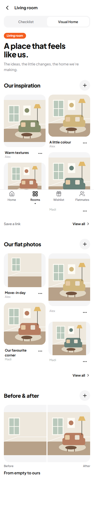
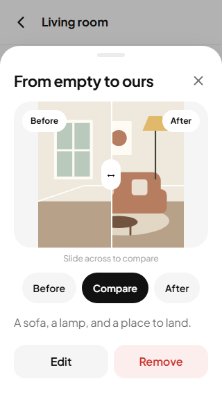

# Phase 5 — Visual Home

Status: implementation and release verification in progress. Production deployment details will be completed after verification.

## Scope and preservation

Built from main `9bc445638f652a3d591a5ffa57e8f61a2428dd47`, after reviewing `PHASE_04_IMPLEMENTATION.md`, the current application, database policies, private storage and security advisories. Dedicated branch: `phase-5-visual-home`; PR: https://github.com/JayJett/Flat-Quest/pull/4.

The approved refinement is one image-led room overview, not another dashboard or a nested tab hierarchy. Phase 6 is not included. No existing household content, media or recovery snapshots is authorized for deletion during this work.

## User experience

- Room-level Checklist / Visual Home switch; the checklist remains the original room route and default entry.
- One cohesive Visual Home overview: **Our inspiration**, **Our flat photos**, **Before & after**. Each gallery has a simple View all route parameter and returns to the overview.
- Shared inspiration images and source-only links, with optional titles, notes and source links. Links accept HTTP(S), reject embedded credentials in the editor and open with `noopener noreferrer`.
- Multiple image uploads, up to 20 per selection, processed sequentially to bound mobile memory usage. Titles and dates are not required. Previews show waiting, saving, added, failed and cancelled states. Retry preserves the upload reservation and stable card ID, avoiding duplicate cards after a lost save response.
- Stop remaining uploads, retry individual failures, edit optional details, and move cards earlier/later with accessible controls. Editing uses the server version to reject conflicting writes while retaining the draft.
- Full-screen image viewer with horizontal swipe, previous/next buttons, keyboard arrows, zoom, native scrolling when zoomed, Escape, focus trapping and focus restoration. Safe-area spacing is retained. Images are contained rather than stretched or destructively cropped.
- Transformations pair two different flat photos from the same room. A directly draggable/keyboard-operable comparison slider, Before/After alternatives, optional title and notes, editing and removal are included. Removing a transformation retains its photos. Removing a photo explains and atomically removes its dependent comparisons.
- Existing typography, colour tokens, four bottom tabs, flat surfaces, rounded controls, sheets, toasts and reduced-motion configuration are reused. No normal-card shadows, decorative blobs, new font family or new UI framework.

## Images and performance

Visual Home is a lazy route, approximately 29 KB uncompressed / 9.2 KB gzip in the verified build. No new npm runtime dependency was introduced.

Main images are re-encoded on-device at a maximum 1600-pixel edge, with a 1000-pixel fallback if necessary; thumbnails use a 480-pixel edge. Output is WebP with JPEG fallback, retaining aspect ratio and removing original EXIF/location metadata. The existing private `household-media` bucket retains its 3 MiB object limit. Inputs above 15 MiB or unsupported formats receive an error. HEIC/HEIF decoding depends on browser support; users can provide JPEG/PNG when decoding is unavailable.

Stored aspect ratios reserve card space. Thumbnails are lazy-loaded and full images load in the viewer/comparison. Room data loads only when the Visual Home route is opened, with progressive loading in groups of 60 visual records. Referenced comparison photos outside the current page are fetched explicitly. Realtime, reconnect and foreground events refresh the current room. Offline writes are refused with drafts retained; no private image cache is added to the service worker.

Signed URLs refresh before expiry and on foreground/online events. Account and household changes clear the in-memory media cache; generation checks prevent an old request from repopulating a cleared cache.

## Database migration

File: `supabase/migrations/20261112072955_visual_home.sql`, created using the pinned Supabase CLI 2.81.3.

New public tables:

| Table | Purpose and constraints |
|---|---|
| `room_visuals` | Inspiration/photo metadata, optional descriptions/source/date, aspect ratio and order. Composite room/household foreign key, constrained private paths, immutable identity/room/kind/photo fields, server timestamps and creator. |
| `room_transformations` | Same-room before/after references, optional title/notes, creator and timestamps. Distinct photos required; inspiration entries rejected. Photo deletion cascades only dependent comparisons. |

Both tables have membership-based row-level security, explicit column grants, indexed foreign keys and room queries, and Realtime publication membership. Anonymous access is denied.

Private infrastructure:

- `private.media_uploads`: durable reservations for **new** product and Visual Home uploads only. Tracks paths, creation time, available/deleting/deleted state, attempts and last error.
- `private.media_worker_settings`: stores only the cleanup token hash. Both private tables enable RLS and expose no browser policies or grants.
- `reserve_media_upload`: authenticated membership check, constrained kind/extension and server-generated unique paths. Its deliberate elevated privilege is limited to inserting the inaccessible reservation record.
- Private attachment trigger locks the reservation row. Cleanup claims use the same row lock. A claimed path cannot subsequently be attached, preventing deletion/attachment races.
- `claim_media_cleanup`, `finish_media_cleanup`, `authorize_media_cleanup`: worker-only RPCs; execution revoked from PUBLIC, anonymous and authenticated roles, granted only to the backend service role.
- Restrictive Storage policies compose with existing membership policies: reserved files have a bounded upload window, cannot be overwritten and cannot be deleted by a browser token.

The migration does not rewrite existing checklist, shopping, profile, assignment or household rows. No storage object is moved or backfilled into the cleanup registry. Phase 4 recovery snapshots are untouched.

## Media cleanup and backend operations

Implementation: `supabase/functions/media-cleanup/index.ts`.

Scheduling recipe: `supabase/operations/schedule_media_cleanup.sql`.

The worker is a Supabase Edge Function invoked by Supabase Cron/pg_net. A dedicated random scheduler secret is held in Vault; its hash is checked through a service-role-only function. The Edge runtime obtains its service key from its own environment. Neither that key nor the scheduler secret appears in frontend files, build variables or GitHub Pages.

Only explicit new-upload reservations older than 24 hours can be reclaimed, and only when neither full image nor thumbnail is referenced. Up to 100 candidates are processed per run. Deletion uses the Storage API, never SQL deletion of storage metadata. Failures remain in a retryable state with an error record; successful deletion is acknowledged. The worker defaults to dry-run unless `dry_run:false` is explicitly provided by its authenticated scheduler.

Product upload/replacement/option deletion/item deletion now rely on the same durable backend lifecycle. Room cascades and abrupt browser closure therefore no longer lose cleanup responsibility. Existing product files are deliberately preserved; removing their application reference does not silently authorize deleting historical storage.

Pre-implementation dry run: two household-media objects existed (one household photo, one product photo). Both were referenced. No existing orphan was established and no existing object was deleted. Historical objects are excluded from automated deletion irrespective of future reference changes. Any historical cleanup requires a separate inventory and explicit user approval.

Operational verification and final scheduler status: pending release verification.

## Security review

- Revoked unnecessary TRUNCATE, TRIGGER and REFERENCES privileges from authenticated/anonymous roles on the five legacy tables: profiles, households, household_members, rooms and items. Existing DML and RPC permissions remain intact.
- Reviewed the ten existing member-callable SECURITY DEFINER entry points. They have fixed empty search paths, deny anonymous execution and use identity, membership or invite-token checks appropriate to their purpose. Existing invite, import, conversion and household-photo functions were retained; they were not disabled merely to clear advisor warnings.
- The two Phase 4 backup tables remain deliberately inaccessible. New private worker tables follow the same deny-by-default approach.
- Supabase organization plan verified as **Free**. Leaked-password protection remains disabled because it requires Pro or above; no subscription was changed. Reference: https://supabase.com/docs/guides/auth/password-security#password-strength-and-leaked-password-protection.
- Dependency audit identified a moderate development-toolchain minimatch advisory propagated through ESLint/TypeScript-ESLint. A forced breaking toolchain replacement was not performed as part of this feature. Production-only audit and final advisor results are recorded below after verification.

Relevant guidance: [privileged function advisories](https://supabase.com/docs/guides/observability/advisors?lint=0029_authenticated_security_definer_function_executable), [Storage deletion](https://supabase.com/docs/guides/storage/management/delete-objects), [scheduled Edge Functions](https://supabase.com/docs/guides/functions/schedule-functions).

## Tests and fixes discovered

- TypeScript build and ESLint pass.
- 100 unit tests pass, including source-link validation and board ordering.
- Existing 163 database-access assertions and six multi-connection shopping concurrency checks pass against disposable local Supabase in CI after permission hardening.
- New `phase5_verification.sql` verifies gallery/transform permissions, same-room references, immutable room identity, metadata edits, cleanup grace period/claims, dry-run non-mutation, deletion failure/retry, attachment rejection after a claim and room/photo cascades.
- `scripts/verify-visual-storage.mjs` exercises real private Storage HTTP operations against localhost only: uploads, signing, outsider denial, immutable reserved files, protected deletion and worker-RPC denial. It refuses a non-local API URL. Final results pending the expanded CI run.
- Browser fixtures cover the room switch, effortless multi-upload, retry idempotency, full-screen viewing and zoom, optional-field conflicts, reordering/removal, transformation creation/comparison/removal and safe source-only ideas. All fixture HTTP/WebSocket traffic to the production Supabase host is intercepted.
- Initial checks caught and fixed missing editor label associations, a shared trigger referencing a field absent from photo rows, Safari focus restoration, and rapid shopping-filter changes reading stale URL state. The filter fix uses the DOM RouterProvider and synchronous navigation; existing behaviour and URL persistence remain covered by regression tests.
- Final browser totals and CI identifiers: pending final verification.

## Visual evidence

These screenshots use invented room illustrations and test accounts, not live household photographs. They verify layout, image proportions and controls without publishing private content. Generated by `tests/browser/visual-screenshots.spec.ts` with `SHOTS=1`.

| Screen | iPhone-sized 390×844 | Small 320×568 | Desktop 1440×1000 |
|---|---|---|---|
| Overview | [Screenshot](screenshots/p5-iphone-overview.png) | [Screenshot](screenshots/p5-small-overview.png) | [Screenshot](screenshots/p5-desktop-overview.png) |
| Comparison | [Screenshot](screenshots/p5-iphone-comparison.png) | [Screenshot](screenshots/p5-small-comparison.png) | [Screenshot](screenshots/p5-desktop-comparison.png) |
| Full-screen viewer | [Screenshot](screenshots/p5-iphone-viewer.png) | [Screenshot](screenshots/p5-small-viewer.png) | [Screenshot](screenshots/p5-desktop-viewer.png) |

## Release and rollback

Existing GitHub Actions workflow retained: lint, unit tests, production build, isolated browser tests, disposable database checks, then GitHub Pages publish. Added Visual Home database and real Storage checks to the existing database job. Production migrations and Edge deployment are verified separately; Pages remains a static frontend.

Final production migration, worker version, scheduler execution, PR merge, Pages run and live-site checks: pending.

Rollback approach: revert the frontend through the existing Pages workflow, retain additive tables and all new user media, and disable the cleanup schedule if needed. Do not drop tables, restore over live records, delete snapshots or purge storage as a rollback shortcut. Restoring the prior frontend does not require removing the new schema.

## Practical limits

- Physical iPhone hardware, native HEIC conversion across all devices and pinch-zoom gestures are not claimed as verified. The viewer provides explicit zoom and browser touch scrolling; automated coverage includes small-screen WebKit.
- Rearranging uses accessible earlier/later controls, not freeform canvas or drag-and-drop board editing.
- No automatic website scraping, public sharing, AI redesign, video, or Phase 6 features.
- Existing wishlist/product information is preserved. Visual inspiration can carry a source link; this release does not duplicate purchasing state or introduce a separate shopping list.
- Recovery snapshots and historical media remain protected. Any existing orphan cleanup is a separately approved operation.
