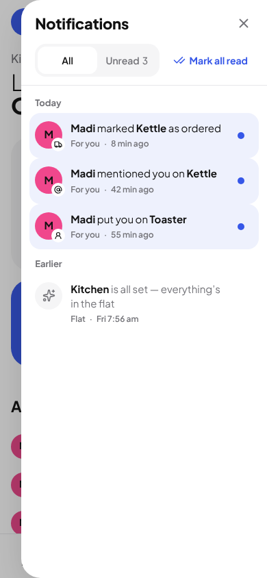
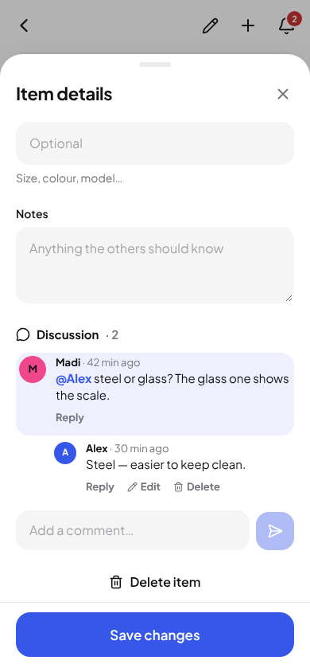
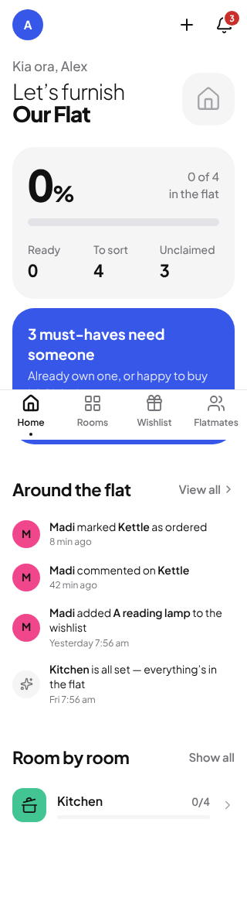
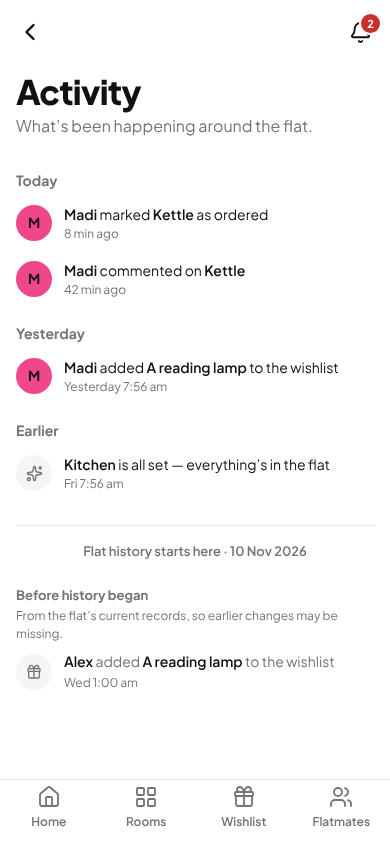
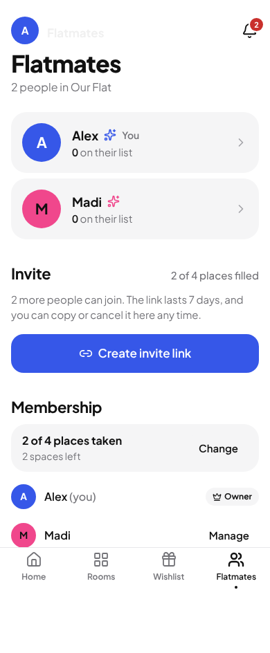
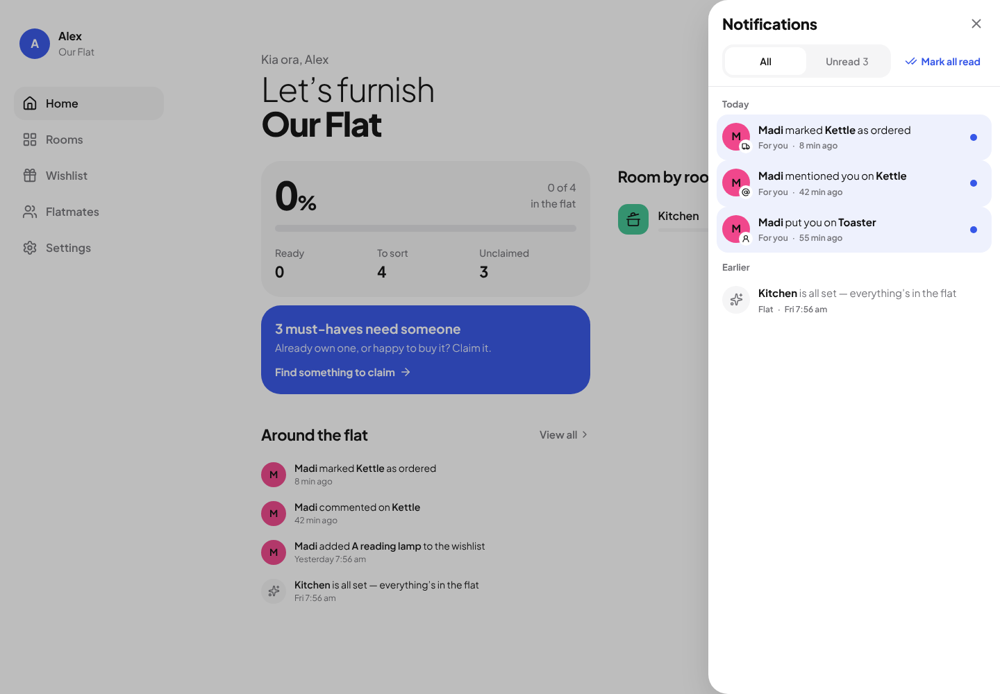

# Phase 6: Connected living

In-app notifications, discussions, a durable activity timeline and household management for Flat Quest. Live at https://jayjett.github.io/Flat-Quest/ from merge commit `53563a6` (15 November 2026).

## 1. Summary

- **Notification centre:** a bell sits at the top right of every main screen, with an unread badge that appears only when something is unread. It opens a right-side drawer that closes by swipe, X, backdrop, Escape or Back, and never opens at the same time as the menu.
- **Notification content:** notifications are grouped Today / Yesterday / Earlier, can be filtered All / Unread, and can be marked read one at a time or all at once. Opening one deep-links to the item, product option, idea, room or flatmates screen.
- **Discussions:** checklist items, product options and wishlist ideas each have a discussion with one level of replies, @mentions, and edit or delete of your own comments.
- **Activity timeline:** "Around the flat" on Home now reads durable history, with a **View all** page at `/activity`. No new tab was added.
- **Household management:** the owner can change capacity, remove a member or transfer ownership. Members can leave. Every action goes through a server function and asks for confirmation first.
- **Delivery:** in-app only. There are no push, email or SMS notifications, and no third-party notification service.

## 2. Scope and preservation

- Home, Rooms, Wishlist, Shopping and Visual Home are unchanged. There are still four bottom tabs, and the white UI, room colours, Plus Jakarta Sans and design tokens are kept, with no new shadows except on the drawer itself (a floating layer).
- No existing data was reset, re-imported or changed. Production after the migration: 1 flat, 3 members, member limit **4 (unchanged)**, 110 items.
- The media cleanup worker and its hourly job (`flatquest-media-cleanup`) are untouched. The Phase 4 recovery snapshots are kept.
- No production member was removed, transferred or used for testing. All destructive tests used synthetic accounts in disposable databases.

## 3. Architecture

- There is one source of truth, `household_events`. Each meaningful change is written once, by a `SECURITY DEFINER` trigger, in the same transaction as the change. A rolled-back or failed write therefore leaves no history, and clients have no way to insert events.
- The timeline reads events flagged `in_timeline`. Notifications reference an event.
- `notifications` holds one row per recipient, enforced by `unique(event_id, recipient_id)`. `read_at` is a server timestamp and only moves forward.
- The browser builds all wording from one library, `src/lib/events.ts`, shared by the drawer and the timeline. Text is returned as plain segments and never as HTML.
- Names are snapshotted into events and comments, so history still reads correctly after someone leaves.

## 4. Database migration

`supabase/migrations/20261115192306_connected_living.sql` was applied to production with your approval, at the version Supabase recorded.

**New tables** (all with RLS):
- `household_events`
- `notifications`
- `comments`

**New member functions:**
- `mark_all_notifications_read`
- `leave_household`
- `remove_household_member`
- `transfer_household_ownership`
- `set_member_limit`
- `member_departure_summary`

**Other changes:**
- A unique index guarantees exactly one owner per flat.
- The raw "members: leave household" DELETE policy and the DELETE grant are replaced by `leave_household()`. This is the only behaviour removed.
- `household_events`, `notifications` and `comments` were added to Realtime, which now publishes 17 tables.
- A retention job, `flatquest-notification-retention`, runs daily at 03:41 UTC. Read notifications are deleted after 90 days and any notification after 180 days. Timeline rows are kept.
- One `history_started` event was written for the existing flat. Nothing earlier was back-filled.

Production verification afterwards was read-only: data unchanged, RLS on, both cron jobs present, old policy gone, snapshots present. The security advisor raised no new errors. It lists the new member functions under the same informational warning as the existing ones; each of them checks who is calling.

## 5. Notification rules (enforced in the database)

| Trigger | Who is told | Reason |
|---|---|---|
| Comment with @mention | each mentioned flatmate | mention |
| Reply | the parent comment's author | reply |
| Comment on something you're on (item assignee, purchase coordinator, option or idea creator) | them, once per thread until read | discussion |
| Assigned / unassigned | that person | assigned / unassigned |
| Item you're on ticked off, or its purchase stage changes (ordered → delivered), or its pick changes | assignees and coordinator | responsible |
| Coordination handed to you / taken over from you / claimed on your item | that person / the assignees | handover / takeover / responsible |
| Room reaches 100%, new before-and-after | all flatmates | milestone (household) |
| Someone joins (and "now full"), someone leaves | other flatmates / the owner | member (household) |
| Ownership handed to you | the new owner | ownership |

**Noise control:**
- You are never notified about your own action.
- A mention takes priority over a reply, and a reply over a discussion notice, with one notification per person per comment.
- An assign/unassign pair within 10 minutes cancels out.
- Only the latest unread purchase-stage update is kept per item.
- A completion undone within 10 minutes leaves no trace.
- Room milestones are not repeated within 12 hours.
- Added items and photos are combined into "added 3 items to Kitchen".
- Edits, imports, no-op updates and failed writes create nothing.

## 6. Notification drawer

- **Shape:** it slides in from the right, at up to 92% of the width on phones and 420px on desktop. It respects safe areas, has a sticky header and an independently scrolling list.
- **Background:** the background page is locked and focus stays inside the drawer. Focus returns to the bell on close.
- **Closing:**
  - X, a tap on the backdrop, Escape, or browser or Android Back. The drawer is a history entry; opening a notification replaces that entry, so Back from the destination returns to where you were.
  - A swipe right: the panel follows the finger and closes past a third of its width or on a quick flick. Otherwise it springs back.
  - A vertical scroll never dismisses it. A finger that rests before letting go doesn't count as a flick.
- **Swipe engine:** the swipe is written with plain pointer events. The motion library's built-in drag behaved differently in WebKit, where CI caught the panel staying displaced.
- **Reduced motion:** the drawer appears without sliding, with no off-screen first frame.
- **Rows and states:**
  - Unread rows are tinted with a dot. Rows have no shadows. Each row carries a "For you" or "Flat" label and a relative time.
  - Empty states read "No notifications yet" and "You're all caught up".
  - Loading and error states are shown. A mark-read that fails is rolled back.
- **Deleted destinations:** a notification about something since deleted shows a message ("That item has since been removed from the list.") instead of a dead end.

## 7. Discussions

- **Rules:**
  - Plain text up to 2,000 characters.
  - One level of replies: a reply to a reply attaches to the same thread.
  - @mention suggestions are limited to current flatmates and are re-checked by the database, which also strips yourself and outsiders.
  - Editing or deleting your own comment is enforced by RLS and a guard trigger.
  - Deleting is a soft delete, so replies keep their place.
- **Server-side protection:** the author and author name are set by the server, so a comment cannot be attributed to someone else.
- **Failure handling:** posting is optimistic. A failed post removes the pending comment and puts your text back in the box. Realtime echoes never duplicate a comment.
- **Arriving from a notification:** you go to the right sheet with the comment scrolled into view and briefly highlighted.

## 8. Activity timeline

- The Home preview shows the latest five entries, and **View all** opens `/activity` (grouped by day, "Show older activity").
- History starts at Phase 6, marked "Flat history starts here". Older completions and hand-added wishlist ideas appear separately under **Before history began**, labelled as coming from current records.
- Rows link to their destination, with the same deleted-content handling as notifications.

## 9. Household management

- The Membership section on Flatmates shows "N of M places taken", members, and an Owner badge.
- **The owner can:**
  - **Change** capacity with a stepper (never below the people already here, at most 12).
  - **Manage → Make owner**, with a confirmation that it can't be undone by them.
  - **Manage → Remove from flat**, with a confirmation that lists what happens to their unfinished items.
- **Members** can **Leave this flat**, with a confirmation. The owner must hand over ownership first, and the flat can never be left without an owner.
- **On leaving or removal:**
  - Assignments, coordination roles, preferences, votes and notifications go.
  - Items left with nobody return to Open.
  - Purchases, photos, options and comments stay, with names kept.
  - Invites are re-checked for capacity.
- Access ends immediately because RLS is checked live. An open session of the removed person receives the membership DELETE over Realtime and reloads.
- Invite revocation is unchanged (the existing panel already handles it).

## 10. Security review

- **RLS:**
  - It is enabled on every new table.
  - You can read and mark only your own notifications.
  - Personal-only events are visible only to their recipients.
  - Timeline, comments and events are scoped to the household.
- **Grants:**
  - No insert or delete grant on events or notifications.
  - Only `update(read_at)` on notifications.
  - Only `update(body, mentions, deleted_at)` on comments.
  - No delete on memberships.
- **Functions:** internal helpers live in the non-exposed `private` schema with `EXECUTE` revoked. Public functions use `set search_path = ''`, take row locks, and re-check owner or membership.
- **Cross-household and Realtime:** cross-household access is denied over both REST and Realtime, which was verified with a real outsider session. The DELETE limitation of Realtime (unfiltered, key only) was checked against current Supabase docs: the app only uses the ids from DELETE events.
- **Data minimisation:** notifications carry no comment text.

## 11. Tests

| Suite | Result |
|---|---|
| `supabase/tests/phase6_verification.sql` (new, rolled back) | 71/71 checks pass, locally on Postgres 16 and on local Supabase in CI |
| `rls_verification.sql` (two steps now use `leave_household`) | 163 rows, all pass |
| Concurrency, Phase 5, real Storage API | pass |
| `scripts/verify-connected-living.mjs` (new): independent signed-in sessions on local Supabase Realtime | 13/13 pass |
| Unit (`tests/events.test.ts` new) | 109/109 |
| Playwright: desktop Chromium, 320 × 568 WebKit, reduced-motion Chromium | 172 passed, 5 intentional skips |

**Phase 6 browser coverage:**
- Bell and badge, and per-user counts.
- Every way of closing the drawer.
- Drag behaviour: follows the finger, springs back, closes past the threshold or on a flick, ignores vertical gestures.
- The two drawers never open together.
- Grouping, Unread view, mark one, mark all, and rollback when marking fails.
- Empty states.
- Deep link and Back.
- Deleted destinations.
- No duplicates after repeated resyncs.
- Keyboard focus trap and reduced motion.
- Discussion post, mention, edit and delete, HTML shown as text, and replies.
- Failed post keeps the draft.
- Option and idea discussions.
- Timeline preview and View all, with no new tab.
- Owner capacity, removal and transfer.

**Real event delivery:** the Realtime script shows:
- Live notification to the recipient's session and to their second device.
- Cross-device read sync.
- No self-notification.
- One notification per person per comment.
- A live timeline update.
- No outsider leakage.
- The removed member's session told immediately.

**Not tested:**
- These are emulated browsers and real local services. No physical phone was used.
- WebKit ran only in CI, not in this environment.

## 12. Issues found and fixed during testing

- **Mention matching:** "@Sam Lee" also counted as a mention of "Sam". Found by a unit test; matched names are now consumed.
- **Drawer swipe in WebKit:** after a short swipe the panel stayed displaced. The swipe was rewritten as an engine-independent pointer gesture.
- **Reduced motion:** the drawer had one off-screen frame. It now starts in place.
- **Realtime script:** it wrote before Realtime had attached to Postgres changes. It now waits for "Subscribed to PostgreSQL".
- **Test timing:** two tests were fixed — one measured while the drawer was still sliding in, and one force-clicked during an animation.
- **Fixtures:** the browser fixtures now mirror the server's completion trigger, because the Home activity reads history.

## 13. Recovery plan

- A snapshot was taken before the migration and kept in the non-exposed `private` schema: `private.phase6_pre_members` (3 rows) and `private.phase6_pre_households`, created by `supabase/rollback/pre_phase6_snapshot.sql`.
- The emergency rollback is `supabase/rollback/20261115192306_connected_living_down.sql`. It drops the Phase 6 objects, unschedules retention and restores the old leave policy. It was exercised locally: down, the policy restored, re-apply, 71/71 passing.
- The rollback deletes comments, notifications and history, so redeploy the previous app version first.
- Remove the snapshot once Phase 6 has settled: `drop table private.phase6_pre_members, private.phase6_pre_households;`.

## 14. Commits (branch `phase-6-connected-living`)

`d879201` database layer · `8d3cc00` notification centre, discussions, activity, management · `b798718` Realtime attach wait, screenshots, polish · `0454840` explicit drawer settle · `155a829` test settle wait · `903ef05` reduced-motion first frame · `12af267` engine-independent swipe · `731132e` migration header and docs · `aec54ff` migration renamed to the production version · merge **`53563a6`**.

## 15. Pull request and Actions runs

- PR: https://github.com/JayJett/Flat-Quest/pull/6 (merged)
- Final branch run: https://github.com/JayJett/Flat-Quest/actions/runs/43752175580 (success)
- Main build and deploy run: https://github.com/JayJett/Flat-Quest/actions/runs/43752795437 (Check and build ✓, Local database access tests ✓, Publish ✓)
- The GitHub Pages deployment for `53563a6` reports success.

## 16. Visual evidence

Invented fixture data only (Alex, Madi, "Our Flat"), at 390 × 844, 320 × 568 and 1440 × 1000 (`reports/screenshots/p6-*`):

- Open notification drawer: 
- Discussion opened from a mention: 
- Home with the bell badge and Around the flat: 
- Activity page: 
- Membership: 
- Desktop drawer: 

Regenerate with `SHOTS=1 npx playwright test phase6-screenshots --project=desktop-chromium`.

## 17. Production checks

- **Read-only database checks after the migration:**
  - 1 flat, 3 members, limit 4, 110 items.
  - One `history_started` event, 0 notifications, 0 comments.
  - RLS on the new tables, 17 Realtime tables.
  - Cron jobs `flatquest-media-cleanup` and `flatquest-notification-retention`.
  - The old leave policy is absent, and both snapshots are present.
- **Live site:** this container's network policy blocks `jayjett.github.io`, so the live site was **not** opened from here. Deployment success is confirmed through GitHub's deployment status only.

Please open the app on a phone and check:
1. The bell shows no badge.
2. Home shows "Around the flat" with **View all**.
3. Flatmates shows **Membership**.

## 18. Known limits and follow-ups

- Item purchases still drop the buyer's link (`purchased_by` set to null) when that person leaves. This is existing Phase 4 behaviour; their name survives in history.
- Notification preferences per type were optional and are not included.
- Timeline rows are kept indefinitely; personal notifications follow the retention job.
- A user deleting their account while owner of a flat with others is not specially handled (account deletion isn't offered in the app).
- Phase 7 has not been started.
