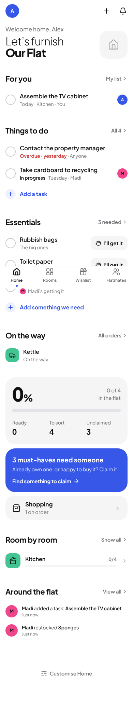
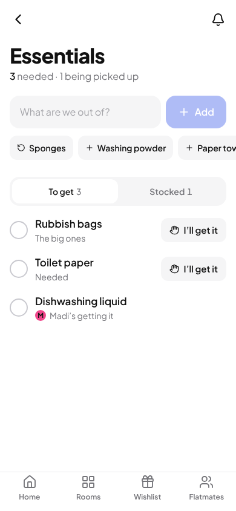
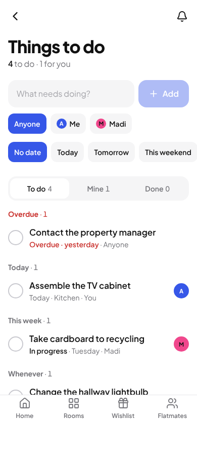
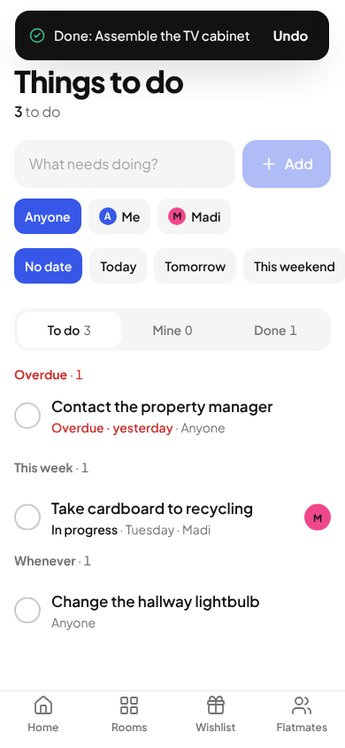
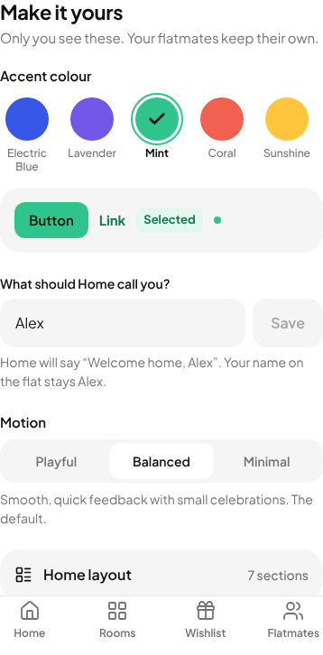
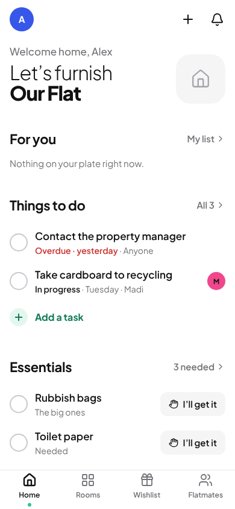
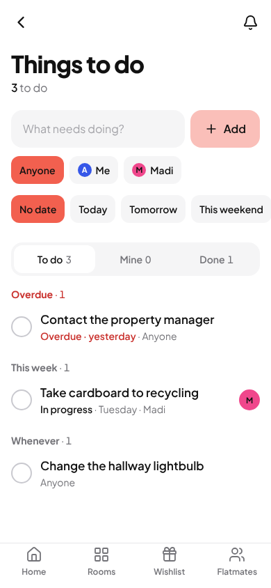
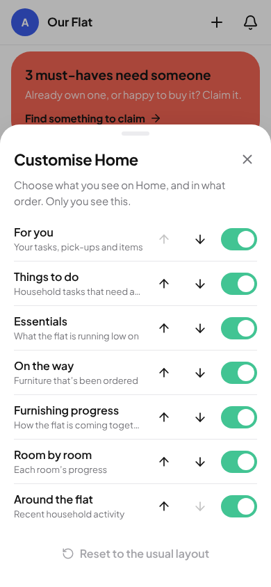
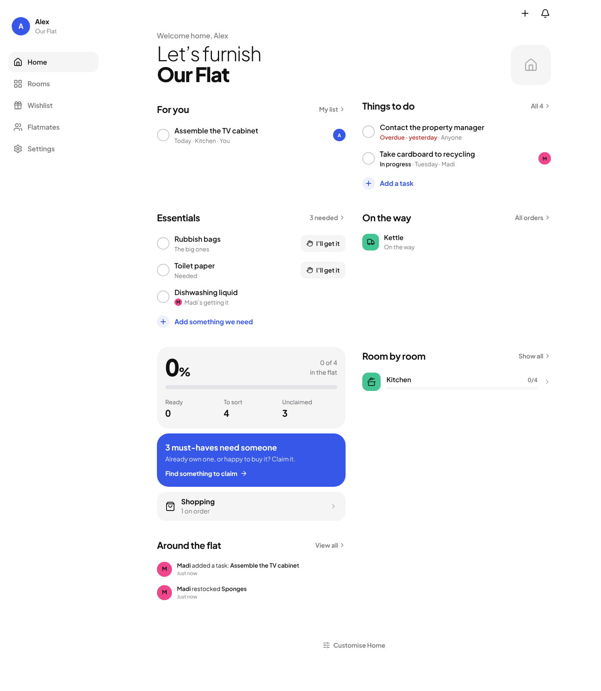
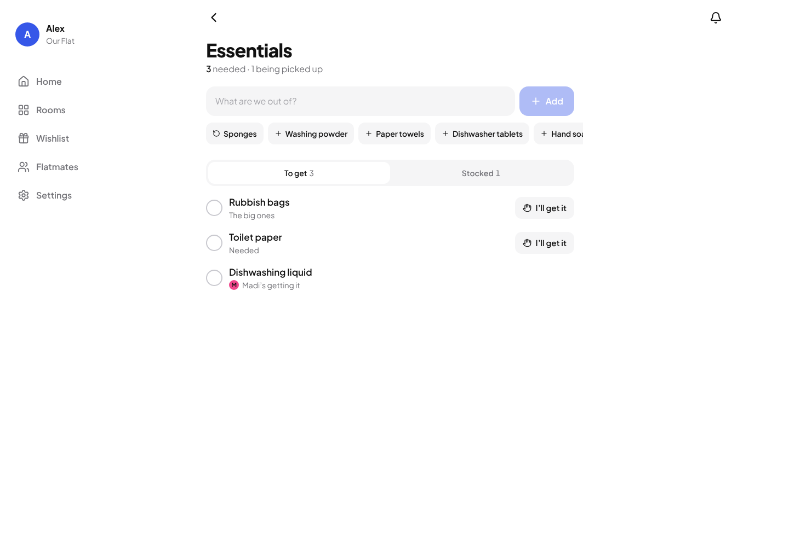

# Phase 7: Living Mode — make it yours

Live at https://jayjett.github.io/Flat-Quest/ from merge commit `7ecbaad` (16 November 2026, NZ time).

## 1. Executive summary

Phase 7 turns Flat Quest from a furnishing checklist into an everyday household companion, without rebuilding it:

- **Household Essentials** (`/essentials`): consumables that run out and get re-bought. They follow *Need it → Someone's getting it → Restocked*, with one row per item for its whole life, so "Need again" never creates a duplicate.
- **Things to do** (`/tasks`): simple tasks with an optional flatmate, room and calendar due date, moving *To do → In progress → Done*.
- **Personal Home:** a time-of-day greeting and seven sections. Each person can hide and reorder them.
- **Make it yours** (Settings): five accessible accent themes, a greeting name, a motion setting (Playful / Balanced / Minimal) and the Home layout, all private to the account.
- **Motion and delight:**
  - A spring tick with ring and sparks.
  - Rows that settle into place.
  - Animated view switches.
  - Undo toasts.
  - A short confetti burst reserved for real milestones: the list cleared, a room at 100%.
- **History and notifications:** these extend the Phase 6 event and notification system with nine new event types. No second log was created.

All automated checks pass in CI. The production database was migrated additively and verified, and no existing data changed.

## 2. Scope delivered

Every Part A–J requirement was implemented, with the limits listed in §16. There are still four bottom tabs, and the bell and both drawers are unchanged. No global search, recurring chores, money tracking, AI or push notifications were added.

**One deliberate behaviour change:** Home's header **+** is now **Quick add** (Essential / Task / Furnishing). Adding a furnishing item from Home therefore takes one more tap. The Phase 3 test that used the old button was updated to the new path, and it still checks the same duplicate-prevention logic.

## 3. Household Essentials

**Data**
- `essentials` holds `name`, `category` (optional, fixed list), `note` (optional), `status`, `claimed_by`, who and when it was needed and restocked, `archived_at`, `created_by` and timestamps.
- A generated `name_key` (lower-case, spacing collapsed) and a partial unique index make the same name impossible twice in a flat.
- `essential_restocks` records each restock: who, when, and what the request looked like just before (used for Undo).

**Lifecycle**
- Every status change goes through `update_essential(p_essential, p_action, p_expected, p_to)`.
- It row-locks the essential, re-checks membership, and refuses stale screens with FQ409.
- Actions: `need`, `claim`, `release`, `handover`, `takeover`, `restock`, `undo_restock`.
- Restock is idempotent: a double tap records one restock.
- Undo is allowed for 10 minutes and only for the person who restocked; it restores the previous state exactly.
- If the person getting something leaves the flat, a composite foreign key clears the claim and a trigger reopens the request.

**Experience**
- **Quick add:** typing ignores case and spacing.
  - Something already on the list says so.
  - Something stocked or archived says *"You've had Sponges before — adding it marks it as needed again"*.
  - Suggestion chips show the flat's own past essentials first, then common ones (toilet paper, rubbish bags…).
- **Rows:** a tick to restock; *I'll get it*, *Let go*, or "Madi's getting it" with her avatar; *Need again* in the Stocked view.
- **Sheet:**
  - Claim, let go, take over, or hand it to a flatmate.
  - Edit the name, category and note.
  - See recent restocks.
  - Archive, then restore later.
- There are no required prices, quantities, receipts or links.

## 4. Things to do

**Data**
- `household_tasks` holds title, notes, `room_id` (must be in the same flat), `assignee_id` (a composite FK to members, set to null on departure), `due_on` (`date`), `status` (`todo`, `doing`, `done`) and `archived_at`.
- `completed_at`, `completed_by` and `created_by` are set by the server.
- Edits use an `updated_at` check, so a conflicting edit is refused rather than overwriting someone else's.

**Experience**
- **Quick add:** the title, plus chips for who (Anyone / Me / each flatmate) and when (No date / Today / Tomorrow / This weekend / Pick a date).
- **Groups:** Overdue (red), Today, This week, Later, Whenever; filters To do / Mine / Done.
- **Completing:** the tick springs in and the row slides into Done. A toast says "Done: …" with Undo. The last open task completed gives "All done. Nice work!" plus a burst.
- **Sheet:** status, reassignment, when, room, notes, archive and restore.
- **Due dates** are calendar dates computed on the device's own calendar (never through UTC): *Today, Tomorrow, Friday, Overdue · yesterday, 25 Dec*. Unit tests cover daylight saving and invalid dates.
- No recurring chores or rotations were added.

## 5. Home screen changes

- **Greeting:** "Good morning / afternoon / evening, {name}", or occasionally "Welcome home, {name}" in the evening. It is stable for the day, with no flicker.
- **Sections**, in their default order:
  1. **For you:** your tasks, what you're picking up, and your furnishing items.
  2. **Things to do:** household tasks needing attention. Yours aren't repeated here while For you is shown.
  3. **Essentials:** what's needed, with an inline restock tick.
  4. **On the way:** ordered, in-transit and ready-to-collect furniture with expected dates.
  5. **Furnishing progress:** the existing card, next action and Shopping link.
  6. **Room by room.**
  7. **Around the flat:** the existing timeline preview.
- Empty sections (no deliveries, no rooms) take no space.
- Each of Things to do and Essentials has an *Add…* row. The header **+** opens Quick add.
- **Customise Home** at the bottom opens the layout sheet.
- Desktop uses two columns. Existing components are reused rather than redesigned.

## 6. Personalisation settings and storage

**Storage**
- `user_preferences` has one row per account, keyed by `user_id`, holding accent, `greeting_name`, motion and `home_layout`.
- RLS allows each person to read and write only their own row. The `user_id` comes from the session and cannot be supplied.
- Changes save straight away, optimistically, and roll back with a message if the save fails.
- A per-account cache on the device (`flatquest.prefs.<user-id>`) applies the theme from the first frame.
- Realtime keeps the same person's other devices in sync.
- The provider is keyed by user id, so switching accounts never carries one person's theme to another.

**Themes**

The accent tokens (`--color-accent`, `-press`, `-soft`, `--color-on-accent`, `--color-accent-ink`) are overridden on `<html>` for that person only. Every pairing meets WCAG AA (≥ 4.5:1), as checked in `tests/personal.test.ts`.

| Theme | Fill | Text on fill | Ink on white |
|---|---|---|---|
| Electric Blue (default, unchanged) | #3657E8 | white 5.7 | 5.7 |
| Lavender | #7357E8 | white 4.9 | 6.0 |
| Mint | #2FC48E | ink 8.5 | 5.3 |
| Coral | #F2604F | ink 5.9 | 5.1 |
| Sunshine | #FFC63D | ink 12.1 | 5.9 |

- To support light accents, 14 `bg-accent text-white` uses became `text-on-accent`, and accent text uses `text-accent-ink`.
- Room colours, success green and error red never change with the theme.
- "In progress" is drawn in ink rather than the accent, so Coral never looks like an error.

**Settings:** Settings → **Make it yours** has swatches with a live sample, the greeting name (your shared display name and history are unchanged), motion with an explanation, Home layout and reset. There is no new navigation tab.

## 7. Animation system and interaction details

- `src/motion/motion.ts` holds one vocabulary: spring presets per motion level (*snappy*, *settle*, *pop*), the press scale, and the confetti count.
- **`TickButton`:**
  - Springs into the checked state, with a slight overshoot on Playful.
  - Plays a ring and six sparks only after the server confirms the change.
  - Gives a light haptic where supported, unless motion is reduced.
- **Lists:** rows enter with fade and lift, exit with fade and slide, and the rest reflow with `layout` springs.
- **Home sections** glide to their new positions when reordered.
- **Views:** switching To get / Stocked / Archived or To do / Mine / Done cross-fades. The Segmented control's existing sliding pill is reused.
- **Empty states:** the icon pops in.
- **Counts:** these use the existing `AnimatedNumber`.
- **Pressable controls:** they get a springier press on Playful and none on Minimal or reduced motion.
- **`CelebrationProvider`:** a 0.9-second burst using the room palette. It ignores pointers and screen readers, never loops, and keeps at most three bursts at once. It is used only when the essentials list is cleared, all tasks are done, or a room reaches 100%. The existing Phase 3 toast still plays alongside it.
- **Toasts** can carry an action (Undo), which keeps them up for 6 seconds.

## 8. Motion accessibility and performance

- **Motion levels:**
  - Playful: more bounce, more confetti (22 pieces).
  - Balanced (default): crisp springs, small celebrations (12 pieces).
  - Minimal: short fades and slides only; no sparks or confetti.
- **The operating system wins:** if it asks for reduced motion, the level becomes `reduced` whatever the app setting. Everything is then instant and decorative effects are off. `MotionConfig reducedMotion="user"` and the CSS reduced-motion rule also stay in place.
- The current level is exposed as `html[data-motion]`, which tests read.
- **Performance:** only transform and opacity are animated, plus brief colour fades. Effects are short, with no perpetual loops.
- **Accessibility:**
  - No action depends on an animation: state, labels and focus update immediately.
  - Reorder uses up/down buttons (works with keyboard and screen readers), not dragging.
  - Background Realtime updates don't trigger celebrations; only confirmed actions by you do.

## 9. Database migration, constraints and RLS

- **Migration:** `supabase/migrations/20261115234314_living_mode.sql`, applied to production with your approval and verified there.
- **Tables:** four new, all with RLS: `essentials`, `essential_restocks`, `household_tasks`, `user_preferences`.
- **Grants are limited to the columns clients may set:**
  - `essentials`: insert name, category, note and status; update details and archive only. Status and claims change only through the function.
  - `household_tasks`: no completion fields.
  - Nothing supports DELETE: items are archived instead.
- **Constraints:**
  - Unique active name per flat.
  - `status = 'getting'` ⇔ claimed.
  - `status = 'done'` ⇔ `completed_at`.
  - Composite FKs keep claimers and assignees inside the flat.
  - Task rooms must belong to the same flat.
  - The preferences layout must be a small JSON array.
- **Indexes** cover every foreign key and the common filters.
- **Events table:** `household_events` gained `essential_id` and `task_id`, and its type check was widened. No existing row was modified.
- **Recovery:** `supabase/rollback/20261115234314_living_mode_down.sql`, exercised locally (down, re-apply, all checks passing again).

## 10. Notification and activity integration

| Change | Timeline | Notified (never the actor) |
|---|---|---|
| Essential needed (new or again) | yes, combined per person per 30 min | nobody |
| Someone claims it | no | whoever asked for it |
| Handed over / taken over | no | the new / previous person |
| Restocked | yes | only the person who was going to buy it |
| Task added | yes | the assignee, if set |
| Task assigned / unassigned | no | that person (a quick reversal while still unread cancels) |
| Task completed | yes | the assignee and creator |
| Restock or completion undone within 10 min | removed | removed |

- The drawer and timeline wording come from the shared `events.ts`, for example "Madi asked you to assemble the TV cabinet" and "Madi restocked Toilet paper — no need to buy it".
- Links go to `/tasks?task=…` and `/essentials?essential=…`. Deleted or archived destinations explain themselves.
- Mark-read and unread counts are unchanged.

## 11. Data preservation checks

**Before** (read-only): 1 flat, 3 members, 110 items, 3 events, 2 notifications, 0 comments, cron jobs `flatquest-media-cleanup` and `flatquest-notification-retention`, 17 Realtime tables.

**After:**
- All of those counts are identical; member limit 4.
- 0 essentials, tasks and preferences.
- 21 Realtime tables, RLS on.
- Both cron jobs present.
- The Phase 4 and Phase 6 recovery snapshots are present.

No membership, furnishing, shopping, Visual Home or media data was touched. Nothing destructive was run.

## 12. Realtime and concurrency behaviour

**Realtime**
- One `living:<flat>` channel per flat for essentials and tasks.
- One `preferences:<user>` channel per person.
- In-flight writes are protected from echoes, and lists de-duplicate by id.
- After a disconnect, returning to the app or coming back online triggers a refetch.

**Concurrency, verified with separate database connections** (`supabase/tests/coordinator_race.sh`)
- 12 simultaneous adds of the same essential: exactly 1 row.
- 12 simultaneous claims from two people: exactly one person getting it. Only the winner's own repeat taps succeed (6); every attempt by the other person is refused.
- 10 simultaneous restocks: none fails, and exactly 1 restock is recorded.

**Real sessions** (`scripts/verify-connected-living.mjs`, local Supabase in CI)
- A new essential appears live for a flatmate.
- A second claim from another session is refused.
- The asker is told live.
- An assigned task arrives with a notification.
- A theme change reaches the same person's other device.
- Flatmates never receive someone else's preferences.
- Outsiders receive nothing.

## 13. Security findings

- RLS is on for every new table. Shared records are household-scoped through `is_household_member`. Preferences are owner-only.
- Clients can't supply attribution (`created_by`, `completed_by`, `claimed_by`, `user_id`).
- Event generation and notification delivery are server-side triggers in the same transaction.
- New internal functions are in the non-exposed `private` schema with EXECUTE revoked. `update_essential` is callable by signed-in users only and re-checks membership. The advisor's informational warning about it matches the existing intended functions.
- Leaving or removal revokes access immediately: claims reopen, tasks become unassigned, and restock history keeps names.
- No secret keys are in the browser.
- Advisor warnings that predate Phase 7 are unchanged: `pg_net` in `public`, and leaked-password protection off, which is a dashboard setting for you.

## 14. Test results

| Suite | Where | Result |
|---|---|---|
| `phase7_verification.sql` (new) | local Postgres 16 and local Supabase (CI) | 61/61 |
| RLS 163-row suite, Phase 5, Phase 6 (71) | both | pass |
| Concurrency (incl. 6 new essential races) | both | all pass |
| Real Storage API / Realtime with independent sessions | local Supabase (CI) | 8/8, 20/20 |
| Unit (`tests/personal.test.ts` new) | local and CI | 128/128 |
| Playwright: desktop Chromium, 320 × 568 WebKit, reduced-motion Chromium | CI | 214 passed, 5 intentional skips |
| Playwright Phase 7 spec repeated 3× (Chromium projects) | local | 84/84 |

**The Phase 7 browser spec covers:**
- Essentials:
  - Quick add, duplicate detection and suggestions.
  - Claim, and a conflict from a stale screen.
  - Restock with a double tap counted once; Undo.
  - Need again.
  - Rollback on a failed write.
  - Hand over, history and archive.
  - Celebration on Balanced, none on Minimal or OS reduced motion.
  - Bursts end within 3 seconds.
- Tasks:
  - Quick add with who and when.
  - Natural due-date groups.
  - Complete and Undo.
  - Status changes and reassignment.
  - A conflicting edit refused.
  - Archive.
  - Deep links from a notification and to a missing essential.
- Home:
  - Greeting and sections.
  - Quick add from Home.
  - Still four tabs.
  - Hide, reorder and reset, persisted across reload.
- Themes and personalisation:
  - The default stays the stylesheet's own value; Mint applies.
  - Dark text appears on a light fill.
  - Persists after reload; room colours unchanged; reset works.
  - Greeting name and motion saved; the OS reduced-motion notice shows.
  - A failed save rolls back.
  - Per-account cache key.
- Keyboard: accent and layout controls work without a pointer.
- Layout: no horizontal overflow at 320px on Home, Essentials, Things to do or Settings.

**Regression:** all Phase 3–6 suites pass. That includes the furnishing checklist, room progress, Shopping, comparisons, Visual Home, notifications and badges, the drawer gestures, discussions, membership, the timeline, sign-in and Realtime.

**Bugs fixed during testing**
- An empty "On the way" section left a blank grid slot.
- A same-person re-claim from a stale screen was wrongly refused.
- Coral "In progress" text looked like an error.
- Your tasks were repeated on Home.

## 15. Visual evidence

All screenshots use invented fixture data (Alex, Madi, "Our Flat"), at 390 × 844, 320 × 568 and 1440 × 1000 (`reports/screenshots/p7-*`):

- Home with everyday information: 
- Household Essentials: 
- Things to do: 
- Task completion moment (toast with Undo; the row has moved to Done): 
- Make it yours with Mint selected: 
- Home in Mint: 
- Things to do in Coral: 
- Customise Home: 
- Desktop Home: 
- Desktop Essentials: 

Animation can't be shown in a still image; §7–8 describe it, and §14 lists the automated evidence. Regenerate with `SHOTS=1 npx playwright test phase7-screenshots --project=desktop-chromium`.

## 16. Known limitations and incomplete features

- **Not tested on a physical phone.** iPhone behaviour was tested only in emulated WebKit (CI) and Chromium. Haptics (`navigator.vibrate`) don't exist on iOS Safari, so iPhones get no haptic.
- **The live site was not opened from this environment.** The container's network policy blocks `jayjett.github.io`. The deployment is confirmed only through GitHub's deployment status.
- Completed tasks are listed for 14 days, then only visible through history. Archived tasks have no screen of their own; they can be restored from a deep link only.
- There are no essential quantities, prices or reminders. Notifications have no per-type settings.
- The essential category list is fixed.

## 17. Manual checks for you

1. Open the app on your phone. Home should greet you by name and show the new sections.
2. Settings → **Make it yours**: try a colour. Only your phone and account change.
3. Add an essential from Home's **+**, tick it off, and try **Undo**.
4. If you use "Reduce Motion" on iPhone (Settings → Accessibility → Motion), confirm the app shows no confetti.

## 18. Pull request, commits and deployment

- PR: https://github.com/JayJett/Flat-Quest/pull/7 (merged)
- Commits:
  - `bcc7725` database layer
  - `11713b8` essentials, tasks, Home, themes and motion
  - `5260ec9` tests, screenshots and polish
  - `db51a87` migration renamed to the production version
  - merge **`7ecbaad`**
- First full branch CI run: https://github.com/JayJett/Flat-Quest/actions/runs/43775376254 (success)
- Final branch run: https://github.com/JayJett/Flat-Quest/actions/runs/43776368343 (success)
- Main build and deploy: https://github.com/JayJett/Flat-Quest/actions/runs/43776967636 (Check and build ✓, Local database access tests ✓, Publish ✓)
- The GitHub Pages deployment of `7ecbaad` reports success.

## 19. Recommendations for Phase 8

1. Notification preferences per type, for example muting completions while keeping assignments. This was deferred by the brief.
2. Gentle reminders for overdue tasks and long-unclaimed essentials, in-app only.
3. An archive view for tasks, and essential quantities with "usually buy" notes.
4. Physical-device testing on the flatmates' actual phones, especially older iPhones, for motion smoothness.
5. Turn on leaked-password protection in Supabase Auth, and remove the Phase 4 and Phase 6 recovery snapshots once you're happy.

Phase 8 has not been started.
