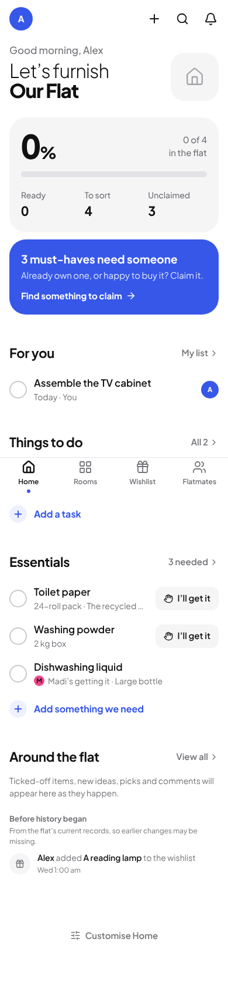
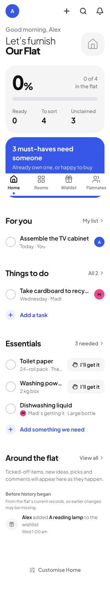
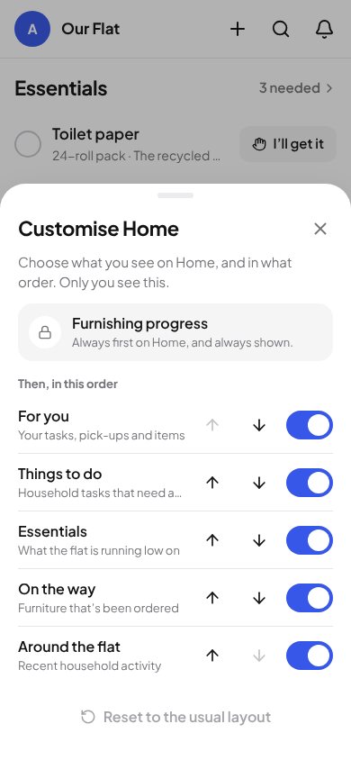
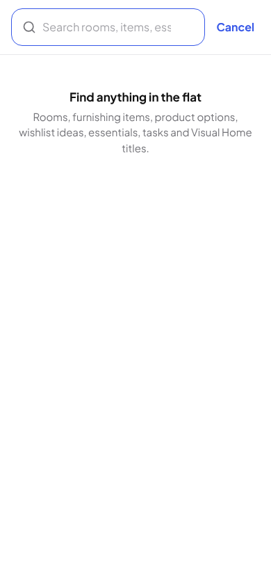
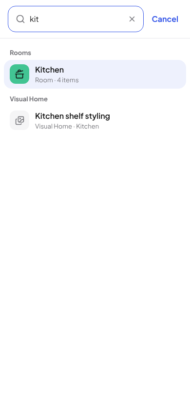
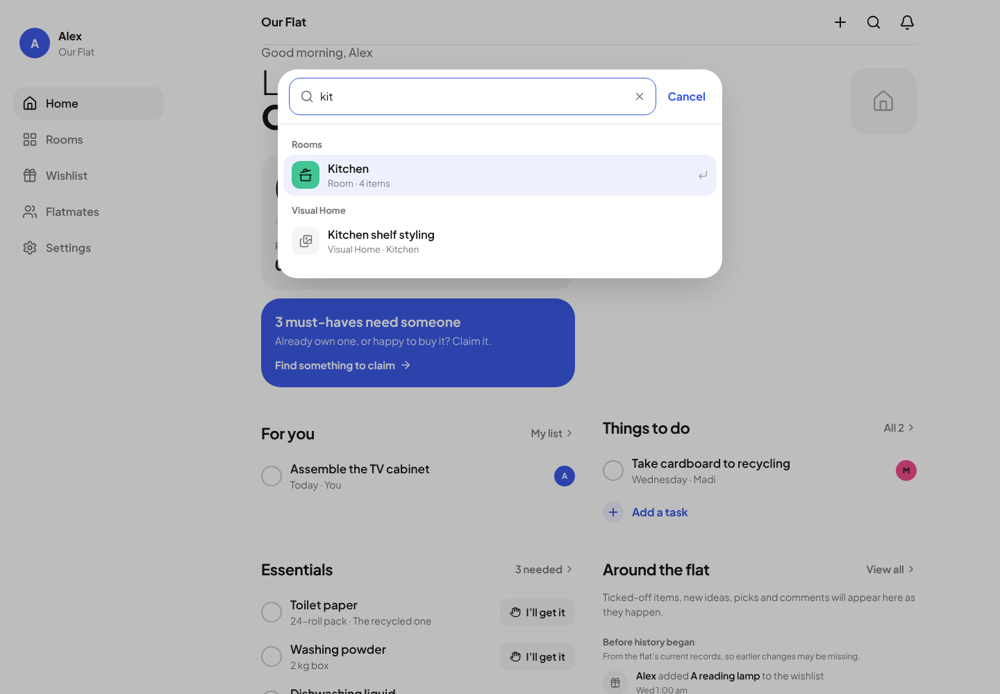
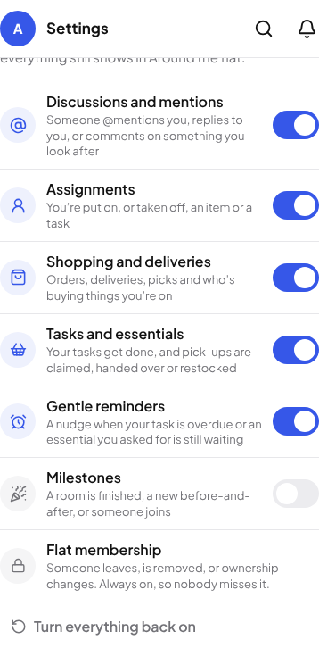
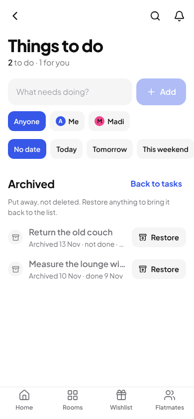
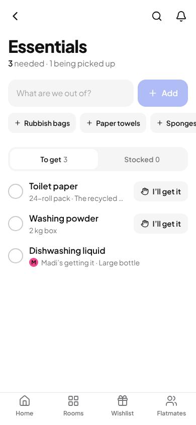
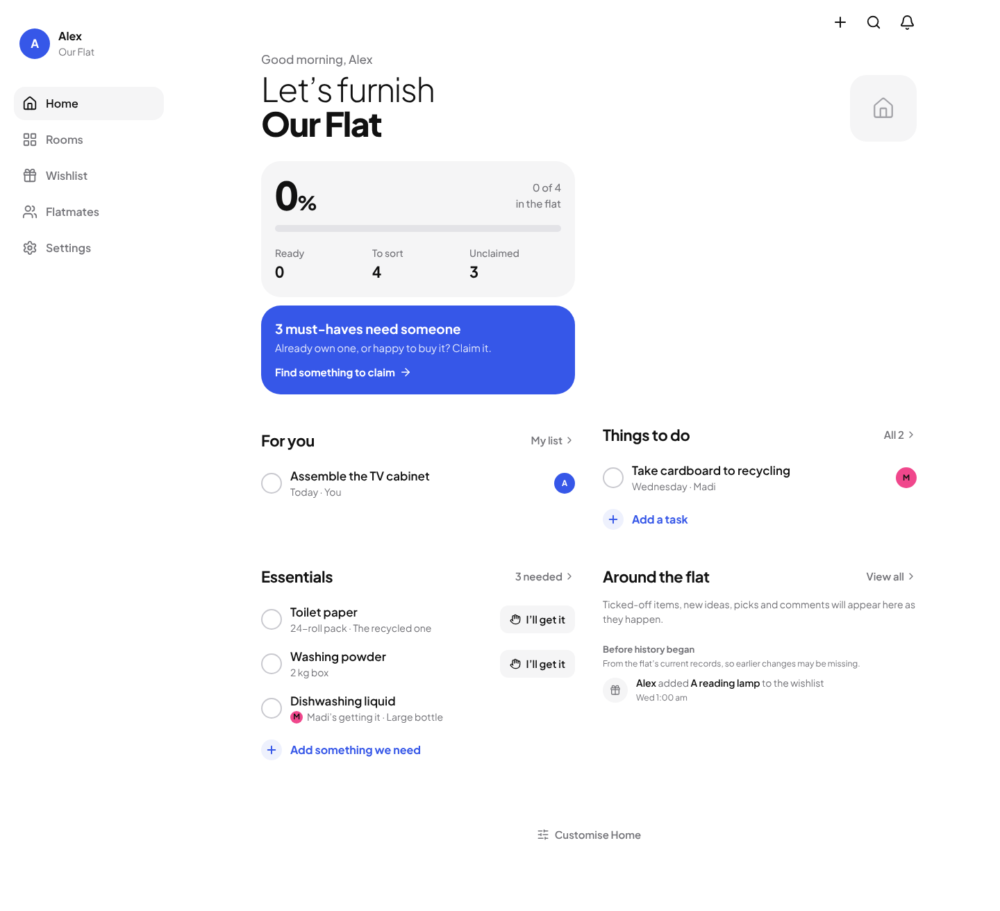

# Phase 8: Find, focus & fine-tune

Live at https://jayjett.github.io/Flat-Quest/ from `b5c5290` (16 November 2026). Database changes are applied and verified in production.

## 1. Executive summary

- **Home:** Furnishing progress is now the first section for every account. It can't be hidden or moved. Room by Room is gone from Home and from the customisation sheet; the Rooms tab is unchanged.
- **Layout migration:** saved Phase 7 layouts are normalised when read. Nobody's preferences were rewritten or reset.
- **Global Search:** the header search button, `/`, or Ctrl/⌘-K searches rooms, furnishing items, product options, wishlist ideas, essentials, tasks and Visual Home titles. Results are ranked and grouped, keyboard-friendly, and open the real destination.
- **Notification preferences:** six personal switches in Settings, enforced where notifications are created in the database. Flat membership notices stay always on.
- **Gentle reminders:** an hourly server job sends low-noise, deduplicated nudges about overdue assigned tasks and long-waiting essentials. It ran successfully in production.
- **Usability:**
  - Archived tasks view with one-tap Restore.
  - An optional "Usual amount" on essentials.
  - Archived essentials restore in one tap.
  - Back returns to your previous scroll position.
  - Double-tap safety fixes.
- **Status:** all automated checks pass in CI, including WebKit. One CI failure on `main` after the first merge was a real double-tap bug; it was fixed in a follow-up PR before anything was published.

## 2. Home screen changes

- **Fixed first section:** Furnishing progress renders outside the personal layout. The existing component is unchanged: calculations, next-action card, Shopping link, animations and styling. On desktop it sits at the top-left, at the width of the first column.
- **Order after it:**
  1. For you
  2. Things to do
  3. Essentials
  4. On the way
  5. Around the flat
- **Customise Home:** a locked "Furnishing progress — Always first on Home, and always shown" row appears above "Then, in this order". The sections below it can still be reordered and hidden.
- **Room by Room removed:** the section, its Home-only code and its imports are gone (`RoomsSection`, `roomProgress`, `RoomIcon`). No blank grid slot remains, and empty sections collapse as before.
- **Unaffected:** the Rooms tab, room pages, progress data, Shopping, Visual Home, and the tour (its progress step now always has a target).
- **Changed test:** the one Phase 7 test that encoded the old layout was updated to the new rules. A test now confirms the Rooms tab still opens.

## 3. Old Home layout migration and normalisation

`normaliseLayout()` runs whenever preferences are read, on every device, after refresh and after sign-in:

- `progress` and `rooms` entries are dropped. They are no longer valid ids in the personal layout.
- Every other valid section keeps its saved order and its hidden or visible state.
- Unknown ids and duplicates are ignored, and any missing section is appended as visible.
- Nothing is written back just by reading. The next time the person changes something, the clean layout is saved.

**Production:** one person had a saved layout containing the retired ids. It was left exactly as stored and is normalised when the app reads it. A browser test confirms reading doesn't rewrite stored preferences, and a unit test turns a Phase 7 layout into the expected Phase 8 order.

Account switching is unchanged: preferences are per account, and so is the local cache key.

## 4. Global Search

**Opening and closing**
- Opens from the header search button (beside the bell), or `/` and Ctrl/⌘-K on a keyboard.
- Closes with Escape, Cancel or browser Back. Choosing a result replaces the search history entry, so Back returns to where you were.
- Only one panel is ever open: search, notifications or the menu.

**Layout**
- Phones: full screen, above the tab bar, with safe-area padding and a results list that scrolls on its own.
- Desktop: a 640px panel at the top with a backdrop.
- Motion follows the person's setting and the operating system's reduced-motion setting.

**Content and links**

| Type | Shown as | Opens |
|---|---|---|
| Room | "Room · 4 items", room-coloured icon | `/rooms/:id` |
| Furnishing item | "Furnishing item · Kitchen" | `/rooms/:room?item=` |
| Product option (incl. retailer and notes) | "Product option · for Kettle" | `/rooms/:room?item=&option=` |
| Wishlist idea | "Wishlist idea · Room" | `/wishlist?idea=` |
| Essential (incl. amount, note, category; archived too) | "Essential · Needed / Stocked / Archived" | `/essentials?essential=` |
| Task (incl. notes; done and archived too) | "Task · Today / Done / Archived" | `/tasks?task=` (archived tasks open in the archive) |
| Visual Home title | "Visual Home · Room" | `/rooms/:room/visual?gallery=` |

**Ranking**
- Matching is case-, accent- and spacing-insensitive, and every word typed must match ("tv cab" finds "Assemble the TV cabinet").
- An exact title beats one that starts with the query, which beats a word starting with it, which beats a match anywhere; title matches beat matches in notes. Shorter titles win ties.
- Results are grouped by type, up to 6 per group, with groups ordered by their best match.

**Accessibility:**
- The input is a combobox with a listbox of results; arrow keys move through them and Enter opens one.
- A polite live region announces "N results" or "No results for …".
- Focus is trapped while open and restored on close.

**Architecture and security**
- Search is client-side. Rooms, items, options, essentials and tasks are already loaded for the flat through RLS-protected queries.
- Wishlist ideas and titled Visual Home items are fetched once each time search opens, not on every keystroke, with a 90 ms local debounce.
- No external search service is used and nothing new is exposed.
- The overlay unmounts on close, so state never outlives it. The data comes from providers keyed by user and flat, so switching account or flat can't show stale results.
- A real-session CI check confirms another flat's data is invisible to these queries.

## 5. Notification preferences

**Settings → Notifications:**

| Switch | Covers (event types) |
|---|---|
| Discussions and mentions | comment_added, comment_mention |
| Assignments | item_assigned/unassigned, task_assigned/unassigned |
| Shopping and deliveries | purchase_stage, option_selected, coordination_claimed/handover/takeover, item_completed |
| Tasks and essentials | task_completed, essential_claimed/handover/takeover/restocked |
| Gentle reminders | task_reminder, essential_reminder |
| Milestones | room_completed, transformation_added, member_joined |
| *Flat membership* (always on, locked) | member_left, member_removed, ownership_transferred |

**How it's enforced**
- Choices are stored in `user_preferences.muted_notifications`. RLS limits each row to its owner, and a check constraint rejects unknown or `membership` values.
- `private.notification_category(type)` maps event types to switches. `private.notify()`, the single place notifications are created, skips recipients who have muted that category. The UI doesn't filter anything; the notification simply isn't created.

**Behaviour**
- Defaults are unchanged, with everything on.
- Muting keeps existing notifications, and the shared timeline continues.
- Unmuting affects only new events: no replay.
- Each person's switches are independent. "Turn everything back on" resets only these switches; Make it yours' reset now leaves them alone, and vice versa.
- Switches use the person's accent colour.

## 6. Reminder rules and backend design

- **Job:** `private.send_reminders(p_now)`, scheduled hourly as `flatquest-gentle-reminders` at minute 23. It is SECURITY DEFINER with execute revoked from every API role.
- **Overdue tasks:** a task that is assigned, not done, not archived and has a due date gets:
  - stage 1 once the due date has passed;
  - stage 2 once it is three days past due.

  "Today" uses the flat's own calendar (`households.settings.timezone`, default Pacific/Auckland), never UTC. A test pins this down: at 00:30 on 17 Nov in Auckland (still 16 Nov in UTC), a task due 16 Nov counts as overdue.
- **Long-waiting essentials:** an essential that is needed, unclaimed, not archived and was asked for at least three days ago gets one nudge to whoever asked.
- **Who gets nothing:** unassigned tasks never nudge anyone, and archived, done or stocked items are never nudged.
- **Limits:** only tasks due in the last 14 days and essentials needed in the last 30 days are considered, so switching the job on can't produce a burst about old items.
- **Idempotency:** `private.reminders_sent` has the primary key `(kind, target_id, cycle, stage)`.
  - The cycle is the due date, or when the essential was last needed.
  - Retried, overlapping or missed runs can't double-send. A missed run catches up on the next one.
  - Moving a due date, or needing something again, starts a new cycle.
- **Preferences:** a muted reminder is recorded as handled (no backlog on unmute), and its event is dropped.
- **Wording:**
  - "Friendly nudge: Assemble the TV cabinet was due yesterday."
  - "Still on your list: … Need a hand, or a new date?"
  - "Toilet paper has been on the list for 3 days. Still need it?"

  There are no streaks or scores. Reminders are in-app only and stay out of the shared timeline.
- **Production:** the job's first run (07:23 UTC) succeeded in 50 ms, with 0 reminders due.

## 7. Archived tasks and essential enhancements

**Archived tasks**
- A quiet "Archived tasks" link below the list opens an archive view (not another tab).
- The view loads on demand from the existing `archived_at` field.
- Each row shows "Archived 13 Nov · done 9 Nov / not done · for Madi" and has a one-tap **Restore**.
- Dates are local calendar days, not UTC slices. Deep links to archived tasks open in the archive. History and attribution are untouched.

**Essentials**
- A new optional `quantity` field ("Usual amount", up to 40 characters; e.g. "24-roll pack"), next to the existing note ("the unscented one").
- Rows show it quietly on one line, and it is searchable.
- Quick add stays a single field. There's no counting, depletion or prices.
- Archived essentials show a one-tap **Restore**.

## 8. UI/UX and animation improvements

- Search opens with a soft lift or fade, results fade in briefly, and the selected result is tinted with the accent. Minimal and reduced-motion settings get no movement.
- The task archive view fades in, and rows animate when restored.
- Settings switches animate their thumb and turn the person's accent colour.
- Furnishing progress is outside the animated section list, so it never moves when other sections are reordered or hidden.
- Removing Room by Room leaves no empty animated slot.
- **Scroll restoration:** positions are remembered per history entry, and Back restores them, retrying for a few frames on lazy screens. New screens start at the top. Opening a panel never moves the page.
- **Fixes:**
  - The browser's duplicate clear button is hidden on search fields.
  - Essential status and amount truncate as one line on 320px screens.
- **Double-tap safety:**
  - Tick controls guard with a ref, not just state.
  - Restocking something already restocked is a silent no-op.
- There are no perpetual animations, and nothing new ignores reduced motion.

## 9. Supabase changes, RLS and security

**Migration** `20261116070905_find_focus_finetune.sql` (additive, applied and verified):
- `user_preferences.muted_notifications text[]`, with a check constraint and owner-only column grants.
- `private.notification_category()`, and the updated `private.notify()`.
- The event type and notification reason checks were widened, adding `task_reminder`, `essential_reminder` and `reminder`.
- `private.reminders_sent`: non-exposed, RLS on, all API access revoked.
- `private.send_reminders()`, plus the cron job.
- `essentials.quantity`, with a length check, column grants and trimming in the guard.

**Security**
- No new exposed tables.
- The advisor's only new note is informational ("RLS enabled, no policy" on the private log), which is intended.
- No secrets are in the browser.

**Rollback:** `supabase/rollback/20261116070905_find_focus_finetune_down.sql`.
- Exercised locally: down, Phase 7 suite (61/61), up, Phase 8 suite (30/30).
- That round trip found a real bug: the first rollback dropped `quantity` while the Phase 8 guard still referenced it. It now restores the Phase 7 guard first.

## 10. Data preservation verification

**Read-only checks before and after the production migration**
- Unchanged: 1 flat, 3 members, member limit 4, 110 items, 1 essential, 0 tasks, 10 events, 7 notifications.
- The one preferences row is unchanged, including its layout, and its notification settings default to everything on.
- The cron jobs are now `flatquest-gentle-reminders`, `flatquest-media-cleanup` and `flatquest-notification-retention`. Media cleanup and retention kept running on schedule after the migration.
- The Phase 4 and Phase 6 recovery snapshots are present.

**What was not done:** no reseeding, resets, deletions, or changes to membership, storage or media. No test touched real records.

## 11. Realtime and concurrency testing

**Real independent sessions on local Supabase (CI), 23 checks.** In addition to the Phase 6 and Phase 7 checks:
- A muted person's live session receives no notification for a muted assignment, while the task itself still syncs.
- Earlier notifications remain.
- An outsider sees none of the flat's wishlist ideas, Visual Home items or tasks.

**Concurrency:** the existing races still pass, with separate connections. That covers coordinator claims, option picks, preferences, essential adds, claims and restocks.

**Reminders:** time-travel checks prove a retried run sends nothing new and that there are never more than two nudges per due date.

## 12. Unit, browser and database test results

| Suite | Where | Result |
|---|---|---|
| `phase8_verification.sql` (new) | local Postgres 16 and local Supabase (CI) | 30/30 |
| RLS 163 rows, Phase 5, Phase 6 (71), Phase 7 (61) | both | pass |
| Concurrency races | both | all pass |
| Real Storage / Realtime sessions | local Supabase (CI) | 8/8, 23/23 |
| Unit (new: `tests/search.test.ts`, layout migration) | local and CI | 135/135 |
| Playwright: desktop Chromium, 320 × 568 WebKit, reduced-motion Chromium | CI | 244 passed, 5 intentional skips |
| Phase 7 and Phase 8 specs repeated 3× (Chromium projects) | local | 144/144 |

**The Phase 8 browser spec covers:**
- **Home:** progress first, no Room by Room, the locked row in customise, the Rooms tab still working, and a Phase 7 layout normalised without losing choices or being rewritten.
- **Search:**
  - Every content type, with case-insensitive, partial and multi-word matching.
  - Exact matches first, group labels, and the empty state with its announcement.
  - Arrow keys and Enter, and deep links.
  - Escape, Cancel and Back closing it; reopening empty; only one panel at a time.
  - Mobile full-screen with independent scrolling.
- **Notifications:** switches persist, the always-on membership row, and reset scoping.
- **Reminders:** wording and links.
- **Usability:** archive view and restore, the essential amount, archived-essential restore, quick add unchanged, and Back restoring scroll.

**Regression:** all Phase 3–7 suites pass, including the notification drawer gestures, badges, discussions, Shopping, Visual Home, membership and themes.

## 13. Screenshots

Synthetic fixture data only, at 390 × 844, 320 × 568 and 1440 × 1000 (`reports/screenshots/p8-*`):

- Home with Furnishing progress first and no Room by Room: 
- Small iPhone Home: 
- Customise Home (locked first row, no Room by Room): 
- Search open on mobile: 
- Results across categories: 
- Desktop search: 
- Notification preferences: 
- Task archive: 
- Essentials with amounts and notes: 
- Desktop Home: 

## 14. Accessibility and performance findings

- Search uses the combobox and listbox pattern with `aria-activedescendant`, a live result count, a focus trap, and Escape to close. Every result is at least 56px tall.
- Switches have accessible names. The membership row is described as locked, not presented as a disabled switch.
- The reorder controls still use buttons, so no dragging is needed.
- **Performance:** search scores at most a few hundred records per keystroke, in memory, with no network. Two small queries run when search opens. Reminders took 50 ms in production.
- No horizontal overflow at 320px was found in the screens tested.

## 15. Known bugs and deliberate limitations

- **Not tested on a physical phone.** iPhone behaviour was tested only in emulated WebKit in CI.
- **Live site not opened from this environment.** The container's network policy blocks `jayjett.github.io`, so deployment is confirmed only through GitHub's deployment status.
- Search covers only titled Visual Home items (titles are optional), and it doesn't search discussion text.
- Reminders use the flat's timezone, defaulting to Pacific/Auckland. There is no UI to change it.
- Reminder cadence is fixed (tasks: due and +3 days; essentials: 3 days), with no per-person schedule.
- The archive view shows the latest 200 archived tasks.

## 16. Deployment evidence and commit hashes

- **PRs:**
  - https://github.com/JayJett/Flat-Quest/pull/8 (feature, merged)
  - https://github.com/JayJett/Flat-Quest/pull/9 (follow-up fix, merged)
- **Commits:**
  - `350c891` database layer
  - `b21dee7` rollback fix
  - `fb7efe2` Home
  - `9e0a36d` search, settings, archive, amounts, scroll
  - `7d82418` tests and polish
  - `c4db39b` migration renamed to the production version
  - `cb8734e` double-tap guard
  - merge `36fcf74`
  - `4d3ed0f` silent no-op for a second restock
  - merge **`b5c5290`**
- **CI:**
  - Feature branch: https://github.com/JayJett/Flat-Quest/actions/runs/43820759274 and https://github.com/JayJett/Flat-Quest/actions/runs/43823096178 (success)
  - First `main` run: https://github.com/JayJett/Flat-Quest/actions/runs/43824029413. **Failed** (one WebKit test exposed the double-tap no-op toast), so **nothing was published**.
  - Follow-up PR: https://github.com/JayJett/Flat-Quest/actions/runs/43825364594 (success)
  - Final `main`: https://github.com/JayJett/Flat-Quest/actions/runs/43826267547 (Check and build ✓, Local database access tests ✓, Publish ✓)
- **Deployment:** the GitHub Pages deployment of `b5c5290` reports success.
- **Production database:** migration `20261116070905` is applied. The reminder job's first run at 07:23 UTC succeeded.

## 17. Recommendations for Phase 9

1. Physical-device QA on the flatmates' phones, especially search with the iPhone keyboard and drawer gestures.
2. Let the owner set the flat's timezone and a "quiet hours" window for reminders.
3. Search discussion comments, and add recent searches stored per person.
4. Turn on leaked-password protection in Supabase Auth, and remove the Phase 4 and Phase 6 recovery snapshots once you're comfortable.
5. Consider a weekly in-app digest for people who mute most categories.

Phase 9 has not been started.
